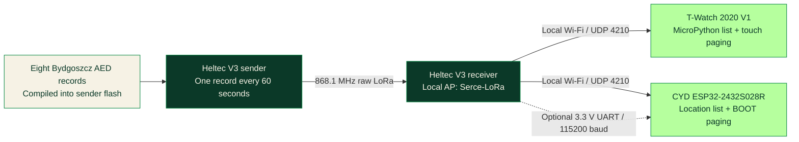
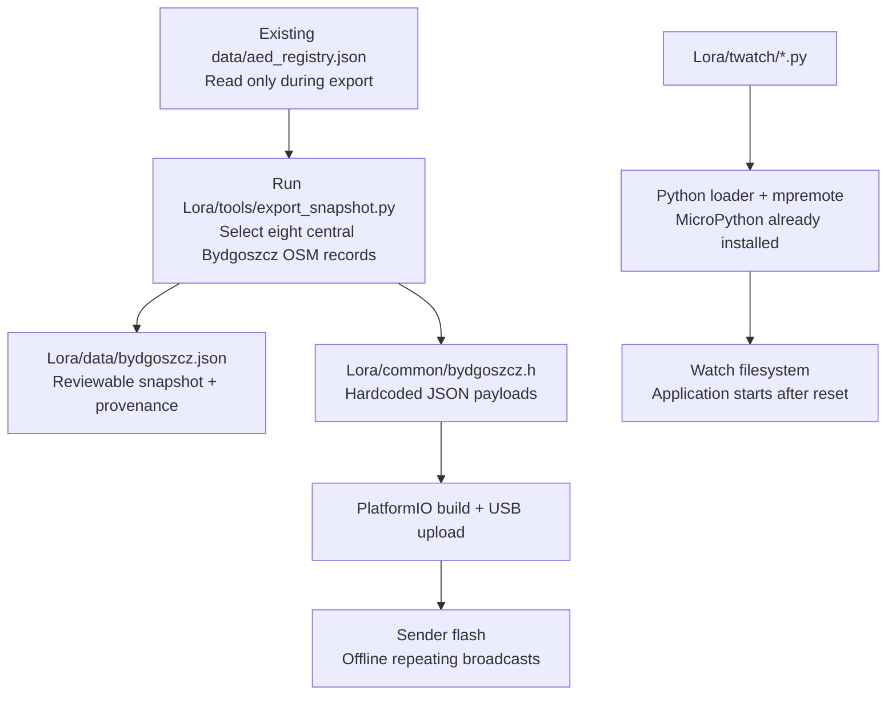
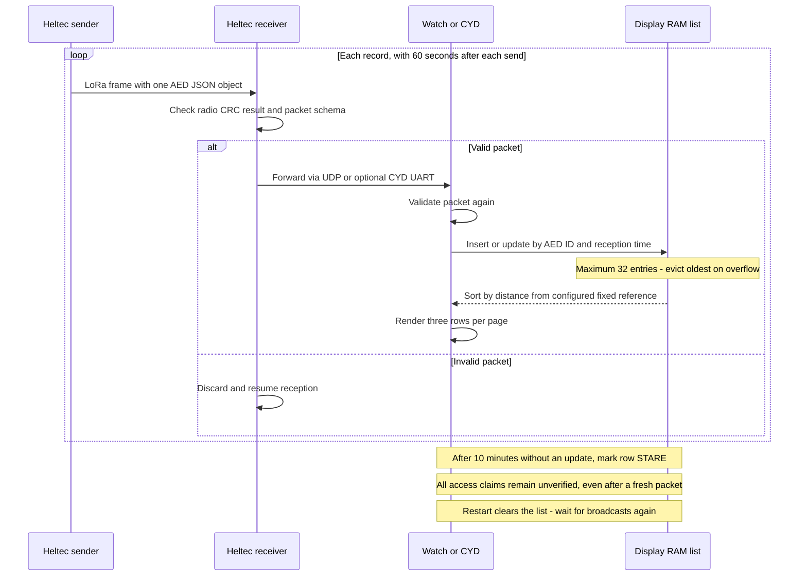

# Serce Okolicy · LoRa devices

Standalone firmware prototypes, entirely separate from the Python server, PWA and data pipeline. The sender has eight Bydgoszcz AED locations compiled into flash; it needs no server, phone or internet. The watch and CYD show received locations in distance order, with cream cards, forest green headers and a mint heart matching the application.

## Hardware supported by these examples

| Folder | Target | Role |
| --- | --- | --- |
| `heltec_sender/` | Heltec WiFi LoRa 32 **V3**, ESP32-S3 + SX1262, 868 MHz variant | Broadcast one hardcoded location every **60 seconds**, cycling forever |
| `heltec_receiver/` | A second identical Heltec V3 | Receive LoRa, forward over a local Wi-Fi AP and optional UART |
| `twatch/` | LilyGO **T-Watch 2020 V1**, ESP32 + AXP202 + ST7789 + FT6336, running MicroPython | Receive the Heltec bridge's UDP packets; tap to page through the list |
| `cyd/` | Classic **ESP32-2432S028R**, ILI9341 320×240 landscape | Receive bridge UDP or UART; press BOOT to page |

**The T-Watch 2020 and CYD have no onboard LoRa.** The Heltec is their external radio receiver. Both displays can share one bridge when nearby, or each can use its own receiver when separated. The watch must remain within Wi-Fi range of its receiver. This implementation is not native LoRa firmware for a T-Watch S3, not a Heltec V2/SX1276 build, and not a universal CYD display driver. Confirm the printed hardware revision before flashing. No existing Python loader was found in this repository, so `tools/load_watch.py` is supplied here.



No router or internet is involved. The bridge's default IP is `192.168.4.1`, its password is `serce-okolicy`, and it broadcasts UDP to port `4210`. Change the credentials together in `common/config.h` and `twatch/config.py` if needed. Power the boards separately over USB/battery and attach matching antennas before running the radios.

## Build and load the ESP32 firmware

Run from the repository root. Dependencies are isolated from the main application's environment.

```sh
python3 -m venv Lora/.venv
Lora/.venv/bin/python -m pip install platformio mpremote

Lora/.venv/bin/pio run -d Lora/heltec_sender
Lora/.venv/bin/pio run -d Lora/heltec_receiver
Lora/.venv/bin/pio run -d Lora/cyd

# Replace ports with those of each board; flash only the matching firmware.
Lora/.venv/bin/pio run -d Lora/heltec_sender -t upload --upload-port /dev/ttyUSB0
Lora/.venv/bin/pio run -d Lora/heltec_receiver -t upload --upload-port /dev/ttyUSB1
Lora/.venv/bin/pio run -d Lora/cyd -t upload --upload-port /dev/ttyUSB2
Lora/.venv/bin/pio device monitor --port /dev/ttyUSB1 --baud 115200
```

On Windows use the executables in `Lora/.venv/Scripts/` and ports such as `COM5`. The PlatformIO files pin the ESP32 platform, RadioLib, ArduinoJson and TFT_eSPI versions. The first build downloads those dependencies. Builds and uploads replace firmware on the selected device; they do not deploy or modify the main application.

The Heltec radio uses SPI SCK=9, MISO=11, MOSI=10, CS=8, DIO1=14, reset=12, busy=13, with a 1.8 V TCXO. Radio settings on both boards: 868.1 MHz, bandwidth 125 kHz, spreading factor 7, coding rate 4/5, sync word `0x12`, CRC enabled, 10 dBm output, 8-symbol preamble. This is raw point-to-point LoRa, not LoRaWAN or Meshtastic. Keep the conservative 60-second interval when trying this preset; changing band, antenna, power or cadence requires checking the applicable local radio limits. A packet is capped at 240 bytes; a full eight-location cycle takes about eight minutes.

CYD display pins and driver are isolated in its `platformio.ini`. No global library setup file needs editing. This build deliberately uses BOOT for paging and does not require resistive-touch calibration. Release BOOT before restarting the board, since it also selects the bootloader.

For the optional wired CYD connection, set `USE_UART = true` in `cyd/src/main.cpp`, rebuild, and connect **Heltec GPIO45 TX → CYD GPIO35 RX**, plus **GND → GND**. UART is 115200 baud, 8N1, 3.3 V logic. Do not connect 5 V to a GPIO. UART is disabled by default so an unwired GPIO35 cannot introduce noise. Wi-Fi and UART duplicates are merged by AED ID. Both displays work over Wi-Fi with no GPIO wiring.

## Load the Python watch app

Install the standard **ESP32_GENERIC MicroPython** firmware on a T-Watch 2020 V1 using the [official board installation instructions](https://micropython.org/download/ESP32_GENERIC/). This is the classic ESP32 target, not ESP32-S3. The supplied application uses MicroPython's built-in `machine`, `framebuf`, `network` and `socket` modules and includes its own small display/touch driver; LVGL and external Python drivers are not required.

Once the watch exposes a working MicroPython serial REPL:

```sh
# Optional: copy existing watch files somewhere safe first.
Lora/.venv/bin/python -m mpremote connect /dev/ttyUSB3 fs ls

# Upload config/model/display first, then main.py, and reset the watch.
Lora/.venv/bin/python Lora/tools/load_watch.py --port /dev/ttyUSB3

# If main.py already exists, this variant backs it up before replacement.
Lora/.venv/bin/python Lora/tools/load_watch.py --port /dev/ttyUSB3 --backup /tmp/watch-main-backup.py
```

The loader replaces `config.py`, `model.py`, `display.py`, and `main.py` on the watch; `--backup` only backs up `main.py`, and intentionally fails if that file is absent. It does not flash MicroPython itself. A failed copy stops the loader. To recover from an application error, connect with `mpremote`, interrupt execution and inspect the traceback. A missing AXP202 at address `0x35` generally means a wrong board revision or a power/I²C problem. Do not apply this driver to a watch with a different power-management chip.

The watch driver uses LCD SPI MOSI=19/SCK=18/CS=5/DC=27/backlight=12, power I²C SDA=21/SCL=22, and touch I²C SDA=23/SCL=32. The screen refreshes once per second. Tap and release anywhere to advance a page. Wi-Fi retries every 15 seconds. This prototype keeps the display and Wi-Fi awake; battery optimization and deep sleep are not implemented.

## Location meaning and data

“Punkt demo / nie GPS” means distance from a **fixed reference** at `(53.1235, 18.0084)`, not the user's current position. Edit `ORIGIN_LAT`/`ORIGIN_LON` in `common/config.h` for CYD and `ORIGIN` in `twatch/config.py` for the watch, then reload. Distances are straight-line Haversine distances, not walking routes. There is no GPS integration or live movement tracking.

`data/bydgoszcz.json` records the source and snapshot timestamp. `common/bydgoszcz.h` is the literal flash-resident copy transmitted by the sender. The eight records were selected from imported OSM records in `data/aed_registry.json` around central Bydgoszcz. We deliberately do not use the repository's unverified municipal demo feed. Coordinates describe an imported snapshot, not a fresh field inspection; all packets carry `a: "unverified"`, and both displays show `NIEZWERYF.`. No live availability or readiness is inferred from reception.

Attribution: **© OpenStreetMap contributors**, [ODbL 1.0](https://www.openstreetmap.org/copyright), via [OpenAEDMap](https://openaedmap.org/). IDs preserve the OSM node references; names and placement descriptions are shortened and transliterated to ASCII for the tiny built-in device fonts. The snapshot is not a complete city registry.

The sender never reads JSON at runtime. To deliberately refresh the committed snapshot from a local registry and regenerate the header:

```sh
python3 Lora/tools/export_snapshot.py
# Review Lora/data/bydgoszcz.json and Lora/common/bydgoszcz.h, then rebuild sender.
```

## How the snapshot reaches the devices

The export step is an explicit developer action. Once flashed, the sender runs from its own copy of the data; neither the server nor the registry file participates in radio operation. Refreshing the registry alone does not change what is broadcast: regenerate, review, rebuild and reflash the sender.



## Packet contract and receiver behavior

Each radio frame is one compact JSON object, without a newline. UART adds a newline; UDP carries the same object in a single datagram.

```json
{"v":1,"id":"osm:node-13181246554","lat":53.124031,"lon":18.006256,"n":"Defibrylator AED","p":"Lokalizacja do sprawdzenia","a":"unverified"}
```

Both implementations validate protocol version, finite coordinates within the Bydgoszcz bounding box (53.0–53.3 N, 17.8–18.3 E), printable ASCII strings, field lengths, access marker and packet size. Up to 32 locations are stored in RAM; repeat IDs update the existing entry and reception time, and overflow evicts the least recently heard entry. After ten minutes without reception a row says `STARE`. This age means time since radio reception, **not** time since verification of the AED. Lists clear on restart. No acknowledgments, complete-list synchronization, deletion messages, signatures or sender authentication are implemented; missing packets return on the next cycle. Radio CRC detects transmission errors, not forged data. This is a hardware prototype, not a verified emergency-location service.

## Reception, duplicate updates and stale entries

The bridge forwards each valid radio packet immediately; it does not replay a stored list when a display connects. A newly started display fills gradually as broadcasts arrive. The diagram describes one display; the watch and CYD maintain independent RAM lists.



## Checks and bench procedure

```sh
python3 -m unittest discover -s Lora/tests -v
python3 -m compileall -q Lora
```

Tests cover the snapshot/header contract, malformed and oversized packets, coordinate bounds, duplicate updates, distance ordering and bounded-cache eviction across clock wrap. The three PlatformIO builds check the C++ firmware; actual radio reception, PMU behavior, display colors and touch need a physical bench test.

1. Boot the receiver and both displays. Confirm waiting states, Wi-Fi connection and empty lists.
2. Boot the sender. Confirm successful TX logs and matching JSON on the receiver's serial monitor. Allow a full eight-minute cycle for all eight locations.
3. Confirm distance ordering, three rows per page and paging on watch touch / CYD BOOT.
4. Leave the sender running for a second cycle: entries should refresh without multiplying.
5. Stop the sender for over ten minutes: existing rows should show `STARE`. Restart a display: it should wait for incoming packets again.
6. Restart the bridge and confirm both displays reconnect. For UART, disconnect Wi-Fi or use an intentionally wrong CYD password to verify the wired path alone.

Hardware references used for the board-specific setup: [Heltec V3 pin definitions](https://github.com/Heltec-Aaron-Lee/WiFi_Kit_series/blob/master/variants/heltec_wifi_lora_32_V3/pins_arduino.h), [LilyGO T-Watch 2020 V1 pin definitions](https://github.com/Xinyuan-LilyGO/TTGO_TWatch_Library/blob/master/src/board/twatch2020_v1.h), [CYD display configuration](https://github.com/witnessmenow/ESP32-Cheap-Yellow-Display/blob/main/DisplayConfig/User_Setup.h), [RadioLib configuration](https://github.com/jgromes/RadioLib/wiki/Default-configuration), and [mpremote documentation](https://docs.micropython.org/en/latest/reference/mpremote.html).
