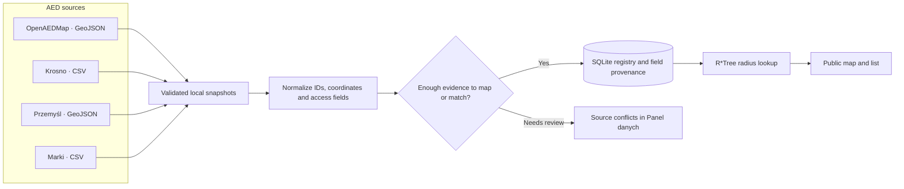
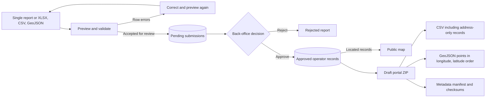
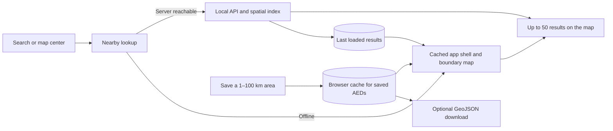

# Odblokuj AED

**A map of defibrillators in Poland with evidence about where to find them and how to get access.** Built for the Misja AED challenge at HackNation 2026.

The app combines four AED data sources, shows nearby devices on a Polish-language map, and lets organizations submit updates for review. The same interface can save a selected area for offline lookup. The back office prepares a draft data package for an authorized dane.gov.pl editor.

## Try it locally

Use Python 3.10 or newer with SQLite R*Tree support. The first import downloads the source snapshots and builds the local index.

```sh
python3 -m venv .venv
.venv/bin/python -m pip install -r requirements.txt
.venv/bin/python prepare_data.py --refresh
.venv/bin/python server.py
```

| Screen | What you can do |
| --- | --- |
| [Mapa AED](http://127.0.0.1:8000/) | Search by place or address, look up devices near your location, and inspect access and sources. |
| [Pełna mapa](http://127.0.0.1:8000/mapa) | Open a map-first view and search around the current map center. |
| [Zgłoś AED](http://127.0.0.1:8000/zglos) | Report a device or preview an XLSX, CSV or GeoJSON batch before submitting it. |
| [Panel danych](http://127.0.0.1:8000/panel) | Refresh source connectors, review conflicts and submissions, and download the draft portal package. |

The server binds to loopback by default. It creates the back-office token in `data/admin-token` on first launch. Read it locally and paste it into **Panel danych**. You can also supply your own token through `AED_ADMIN_TOKEN`.

## How the registry is built



The importer compares distance, names and addresses before merging municipal records with OpenStreetMap entries. The Marki adapter checks axis order and flags coordinates shared by different addresses. It holds the School No. 5 record for review because its reported coordinates fall outside Marki and match a Krosno entry. Each merged record keeps links to the sources behind its fields.

A failed refresh keeps the last valid local snapshot. Rebuild from files already on disk with `.venv/bin/python prepare_data.py`. The main adapters live in [prepare_data.py](prepare_data.py) and the bounded lookup API lives in [server.py](server.py).

## From report to portal package



Operators can download a template or an example from **Zgłoś AED**. The editor ZIP contains approved operator records. The editor still needs to complete the publisher and reuse review before publication. Baseline source data has its own reuse terms. The review and export implementation is in [operations.py](operations.py).

## Nearby search and offline use



- **Zapisz obszar offline** saves up to 8,000 points around the visible map center. Visit the page online first so the service worker can install. Saved points and a simplified boundary map work offline. Street tiles require connectivity. The service worker needs localhost or HTTPS. [OpenStreetMap tile policy](https://operations.osmfoundation.org/policies/tiles/) · [Natural Earth terms](https://www.naturalearthdata.com/about/terms-of-use/)
- The default search filter shows devices with **reported public access**. Green, amber and muted red indicate the strength of the location and access evidence. The point details show why a score was assigned. The score describes the available source evidence. Current device readiness remains unknown.
- **OpenStreetMap** is the default basemap and needs no key. To enable the optional Google Maps switch, supply `GOOGLE_MAPS_BROWSER_KEY` and, optionally, `GOOGLE_MAPS_MAP_ID` when starting the server. Restrict the key to the Maps JavaScript API and your site’s HTTP referrers. [Google Maps setup](https://developers.google.com/maps/documentation/javascript/load-maps-js-api)

## Sources and attribution

- [OpenAEDMap Poland](https://openaedmap.org/api/v1/countries/PL.geojson) uses data from [© OpenStreetMap contributors](https://www.openstreetmap.org/copyright).
- Municipal source files come from the [Krosno](https://api.dane.gov.pl/1.4/datasets/3624), [Przemyśl](https://api.dane.gov.pl/1.4/datasets/4581) and [Marki](https://api.dane.gov.pl/1.4/datasets/4955) catalogues.
- The map uses [Leaflet](static/vendor/LEAFLET-LICENSE), a Natural Earth boundary layer, and the OpenStreetMap basemap. Font notices are in [static/brand](static/brand).
