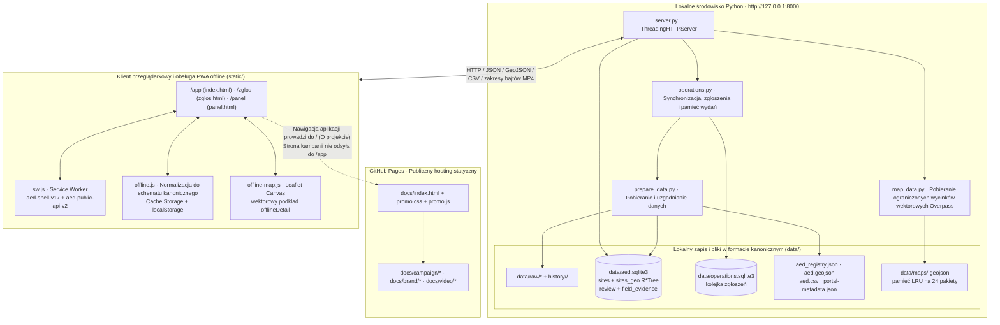
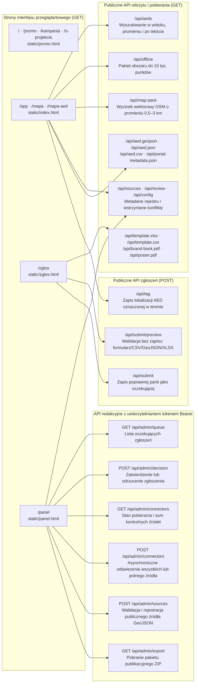
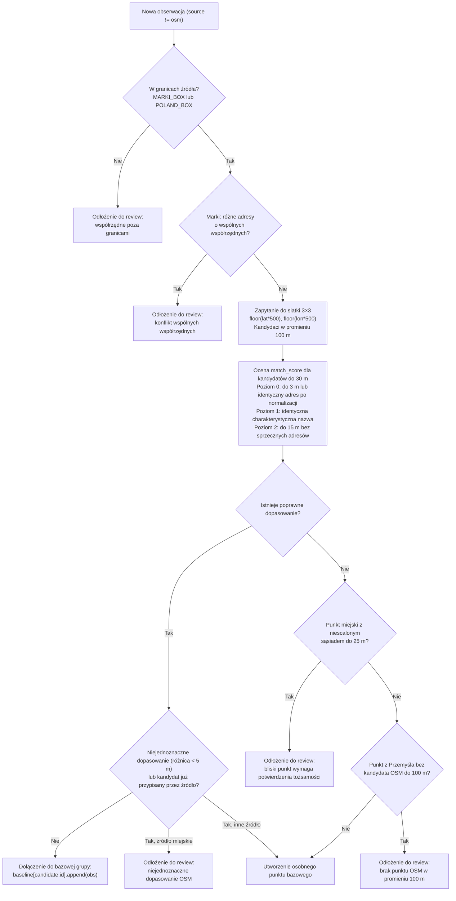
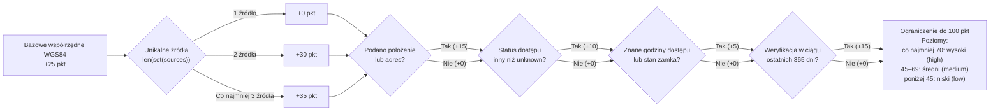
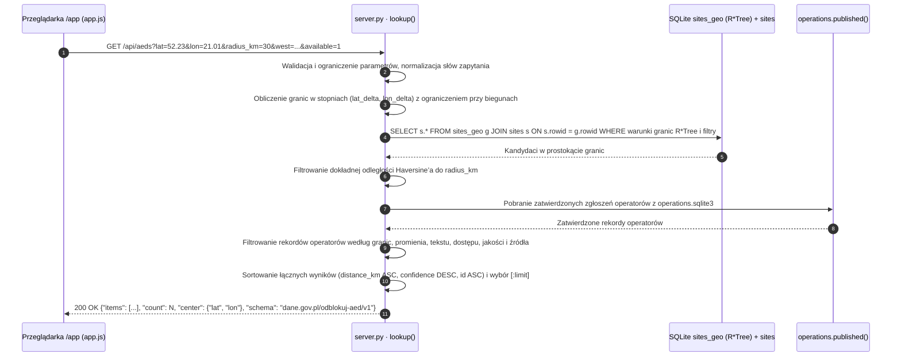
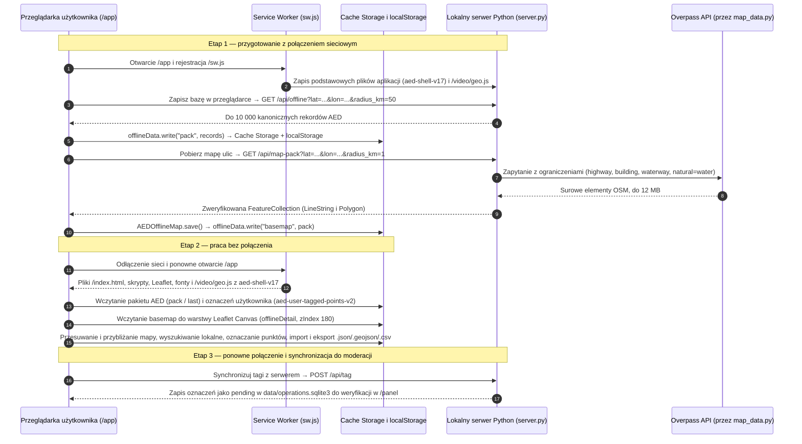

# Serce Okolicy · Odblokuj AED

**Serce Okolicy · Odblokuj AED** to system agregacji otwartych danych o automatycznych defibrylatorach zewnętrznych (AED), rejestr przestrzenny oraz progresywna aplikacja internetowa (PWA) działająca offline. Projekt obejmuje przyjmowanie zgłoszeń od organizacji i panel redakcyjny z uwierzytelnianiem. Powstał na potrzeby wyzwania **Misja AED** (`dane.gov.pl`).

Projekt rozdziela **publiczną stronę kampanii**, publikowaną jako witryna statyczna w **GitHub Pages**, od **aplikacji Python + SQLite R\*Tree**, uruchamianej lokalnie i obsługującej pracę offline bez zależności od chmury:

- **Publiczna strona kampanii (GitHub Pages):** [`https://rodrigogaluppo.github.io/HACK_NATION_Serce_Okolicy/`](https://rodrigogaluppo.github.io/HACK_NATION_Serce_Okolicy/)
  - Samodzielny zestaw plików statycznych z [`docs/`](docs/index.html), odwzorowany również w gałęzi `gh-pages`.
  - **Nie zawiera odsyłaczy do lokalnych tras aplikacji** (`/app`, `/zglos`, `/panel`), ponieważ aplikacja działa lokalnie, a nie w GitHub Pages.
- **Lokalna aplikacja Python i PWA offline (`http://127.0.0.1:8000`):**
  - Uruchamiana przez [`server.py`](server.py), korzysta z [`prepare_data.py`](prepare_data.py), [`operations.py`](operations.py) i [`map_data.py`](map_data.py).
  - Nawigacja lokalnych stron (`/app`, `/zglos`, `/panel`) prowadzi do `/` (**O projekcie**, czyli strony kampanii), natomiast sama strona kampanii pozostaje samodzielna.
  - Przełączanie języka **PL / EN** jest dostępne na stronie kampanii, mapie PWA, stronie zgłoszeń i w panelu redakcyjnym.

**Zobacz produkt w działaniu:** [zrzuty ekranu mapy, narzędzi offline i panelu danych](#zrzuty-ekranu-produktu).

## Oświadczenie o wykorzystaniu sztucznej inteligencji

**Pomysł na Serce Okolicy, koncepcja produktu i jego założenia są autorstwa naszego zespołu.** Sztuczną inteligencję wykorzystywaliśmy jako narzędzie wspierające realizację naszego pomysłu.

AI pomagało nam w wyszukiwaniu i analizie źródeł informacji oraz w agregacji i porządkowaniu danych o AED. Korzystaliśmy z niego również podczas programowania oraz przygotowywania i wykonywania testów tras i endpointów aplikacji, w tym testów dotyczących ich zabezpieczeń.

W części wizualnej AI wspierało tworzenie ikon i elementów graficznych do filmu oraz opracowanie logo i identyfikacji wizualnej marki. Logo wygenerowaliśmy z pomocą AI w procesie kolejnych rozmów, wskazówek i korekt z naszej strony, zgodnie z przyjętym przez nas kierunkiem wizualnym. AI służyło do rozwijania i realizowania naszych decyzji projektowych, a autorstwo pomysłu i kierunek projektu pozostawały po stronie zespołu.

## Samodzielne prototypy urządzeń LoRa

Katalog [`Lora/`](Lora/README.md) zawiera odrębne oprogramowanie nadajnika i odbiornika Heltec V3, zapisaną na stałe migawkę lokalizacji AED w Bydgoszczy, listę najbliższych lokalizacji na CYD oraz interfejs MicroPython dla T-Watch 2020 V1 ze skryptem wgrywającym w Pythonie. Ekrany odbierają lokalizacje LoRa przez most Heltec. Odległości są liczone od wyraźnie oznaczonego, stałego punktu odniesienia, a nie z GPS. Osobny README opisuje sprzęt, połączenia, wgrywanie oprogramowania, pochodzenie danych i testy. Ten opcjonalny katalog nie zmienia działającego serwera, PWA ani procesu przetwarzania danych.

---

## 1. Architektura systemu i sposób wdrożenia



---

## 2. Szybki start i uruchomienie lokalne

### Wymagania

- **Python 3.10+** ze wsparciem indeksu przestrzennego SQLite **R\*Tree** w module biblioteki standardowej `sqlite3`.
- [`openpyxl`](requirements.txt) do generowania i walidacji wieloarkuszowych plików zgłoszeń `.xlsx`.
- **Node.js 18+** — opcjonalnie, do testów jednostkowych kodu offline po stronie klienta i testów przeglądarkowych Playwright.

### Instalacja i uruchomienie

```sh
python3 -m venv .venv
.venv/bin/python -m pip install -r requirements.txt

# 1. Pobierz źródła, sprawdź sumy kontrolne, uzgodnij rekordy i zbuduj SQLite R*Tree oraz pliki kanoniczne
.venv/bin/python prepare_data.py --refresh

# 2. Uruchom lokalny wielowątkowy serwer HTTP i harmonogram synchronizacji co 24 godziny
.venv/bin/python server.py --host 127.0.0.1 --port 8000
```

- **Odbudowa offline z zapisanych migawek:** po pobraniu źródeł do `data/raw/` uruchom `.venv/bin/python prepare_data.py` bez `--refresh`, aby całkowicie offline odbudować `data/aed.sqlite3` i pliki w formacie kanonicznym.
- **Token administratora:** przy pierwszym uruchomieniu [`operations.admin_token()`](operations.py#L74-L86) generuje kryptograficznie losowy, 24-bajtowy token bezpieczny do użycia w URL i zapisuje go w `data/admin-token` z uprawnieniami `0600`, o ile nie ustawiono zmiennej `AED_ADMIN_TOKEN`. Wklej token w `/panel`, aby odblokować operacje administracyjne.
- **Zmienne środowiskowe:**
  - `AED_ADMIN_TOKEN` — zastępuje token Bearer panelu redakcyjnego przechowywany w lokalnym pliku.
  - `AED_SYNC_INTERVAL_HOURS` — odstęp między odświeżeniami w tle, w godzinach; domyślnie `24`, minimum `1`.
  - `WARSAW_API_TOKEN` — umożliwia pobieranie danych z endpointu defibrylatorów SCB m.st. Warszawy (`get_scb_lokalizacja_defibrylatorow`).
  - `GOOGLE_MAPS_BROWSER_KEY` i `GOOGLE_MAPS_MAP_ID` — opcjonalne ustawienia umożliwiające włączenie warstwy Google Maps online w `/app`.

---

## 3. Struktura repozytorium i przewodnik po kodzie

Każdy moduł odpowiada za określoną część systemu:

```text
.
├── prepare_data.py              # Pobieranie HTTPS z wielu źródeł, normalizacja, uzgadnianie przestrzenne i zapis SQLite/JSON/CSV
├── operations.py                # Synchronizacja co 24 h, walidacja XLSX/CSV/GeoJSON, kolejka moderacji i eksport ZIP
├── map_data.py                  # Wycinki wektorowe Overpass z limitami zapytań (ulice/budynki/woda, promień 0,5–3 km)
├── server.py                    # ThreadingHTTPServer, wyszukiwanie R*Tree i tekstowe, REST API i strumieniowanie zakresów wideo
├── requirements.txt             # Zależności Pythona (openpyxl)
├── scripts/
│   └── extract-campaign.cjs     # Skrypt pomocniczy wyodrębniający grafiki kampanii
├── static/
│   ├── promo.html               # Strona kampanii (/, /promo, /kampania, /o-projekcie)
│   ├── promo.css                # Style kampanii i suwaka porównania map przed/po
│   ├── promo.js                 # Przełączanie PL/EN na stronie kampanii i obsługa suwaka porównania
│   ├── index.html               # Mapa AED jako PWA z obsługą offline (/app, /mapa, /mapa-aed)
│   ├── app.js                   # Obsługa mapy, zapytania dla widoku, filtry, oznaczanie punktów i pakiety offline
│   ├── app-i18n.js              # Słownik PL/EN i tłumaczenie DOM aplikacji mapowej
│   ├── app.css                  # Style mapy, filtrów, ocen pewności i okien dialogowych
│   ├── styles.css               # Wspólne zmienne wyglądu, typografia, nagłówek i układ responsywny
│   ├── offline.js               # Normalizacja schematu, odczyt CSV/GeoJSON/JSON i obsługa Cache/localStorage
│   ├── offline-map.js           # Rysowanie ulic i budynków offline w Leaflet Canvas oraz walidacja geometrii
│   ├── sw.js                    # Service Worker (aed-shell-v17 i pamięć odpowiedzi publicznego API do 80 wpisów)
│   ├── zglos.html               # Zgłoszenia pojedynczych urządzeń i plików XLSX/CSV/GeoJSON (/zglos)
│   ├── panel.html               # Panel redakcyjny i przepływ danych z uwierzytelnianiem tokenem (/panel)
│   ├── office.js                # Obsługa /zglos (podgląd/wysyłka) i /panel (kolejka, synchronizacja, nowe źródło)
│   ├── office.css               # Style formularzy, diagramu przepływu, kart źródeł i kolejki weryfikacji
│   ├── przyklad.geojson         # Przykładowy GeoJSON do testowania zgłoszeń zbiorczych
│   ├── manifest.webmanifest     # Manifest instalacji PWA (ikony, kolory, samodzielne okno aplikacji)
│   ├── brand/                   # Lokalne kroje pisma, logo i licencje OFL
│   ├── campaign/                # Grafiki kampanii (mapy Polski przed/po, trasa w Bydgoszczy, LoRa, ikony)
│   ├── Screenshots/             # Zrzuty ekranu mapy i panelu danych użyte w tym README
│   └── vendor/                  # Lokalny Leaflet 1.9.4 JS/CSS i uproszczone granice Polski w GeoJSON
├── video/
│   ├── geo.js                   # Wektorowa geometria województw, rzek i miast do użytku offline
│   ├── street_heart_logo.png    # Znak marki w nagłówku aplikacji
│   ├── Serce-Okolicy-cover.jpg  # Kadr okładkowy filmu kampanii
│   └── Serce-Okolicy-v4.mp4     # 90-sekundowy film z obsługą zakresów bajtów HTTP 206
├── Lora/                        # Odrębne prototypy Heltec, CYD i T-Watch, dane Bydgoszczy i instrukcje
├── docs/                        # Samodzielna witryna GitHub Pages (index.html, promo.css, promo.js, brand/, campaign/, video/)
├── .github/workflows/pages.yml  # Publikacja docs/ w GitHub Pages przez GitHub Actions po wysłaniu zmian do main
└── tests/
    ├── test_data_pipeline.py    # Testy uzgadniania danych, pochodzenia, wykrywania zasobów i pamięci wydań
    ├── test_map_data.py         # Testy konwersji wektorów Overpass i granic geograficznych
    ├── offline.test.cjs         # Testy Node.js: normalizacja, ochrona przed formułami CSV oraz zapis i odczyt danych
    ├── offline-map.test.cjs     # Testy Node.js: podkład wektorowy offline i granice współrzędnych
    └── browser.mjs              # Testy Playwright: komputer, urządzenia mobilne i ponowne ładowanie offline
```

### Główne moduły zaplecza

1. **[`prepare_data.py`](prepare_data.py)**
   - Definiuje 30 pól kanonicznego schematu `dane.gov.pl` (`FIELDS`), katalog źródeł (`SOURCES`), metadane licencyjne (`SOURCE_METADATA`) i kody TERYT gmin (`TERYT_MAP`).
   - Funkcja [`public_download()`](prepare_data.py#L176-L196) wymusza HTTPS, odrzuca dane uwierzytelniające w URL i porty inne niż 443 oraz sprawdza DNS na każdym etapie, także po przekierowaniach HTTP. Blokuje prywatne adresy IP, adresy pętli zwrotnej i adresy lokalnego łącza, ograniczając ryzyko SSRF.
   - Funkcja [`catalogue_resource()`](prepare_data.py#L199-L216) wykrywa najnowszy zasób `csv` lub `geojson` w zbiorach `dane.gov.pl`, odrzucając zasoby niezwiązane z AED w zbiorach obejmujących różne dane miejskie.
   - Funkcja [`refresh_inpost()`](prepare_data.py#L491-L550) odczytuje kody paczkomatów z AED i równolegle ustala ich współrzędne przez API ShipX (`ThreadPoolExecutor(max_workers=12)`). Zachowuje poprzednie obserwacje, jeśli pobranie danych pojedynczego urządzenia się nie powiedzie.
   - Normalizuje znaki diakrytyczne, usuwa dane osobowe i poufne (`PRIVATE_TEXT`), uzgadnia duplikaty między źródłami (`reconcile`), ocenia jakość dowodów (`compute_confidence`) i atomowo buduje `data/aed.sqlite3` z indeksem `sites_geo` R\*Tree oraz tabelą audytową `field_evidence`. Generuje również `aed_registry.json`, `aed.geojson`, `aed.csv` i `portal-metadata.json`.
2. **[`operations.py`](operations.py)**
   - Uruchamia wątek działający w tle — [`start_daily_scheduler()`](operations.py#L199-L218) — który co 30 sekund sprawdza `RUN["next_sync_at"]` i co `AED_SYNC_INTERVAL_HOURS` inicjuje asynchroniczne odświeżenie wielu źródeł (`start_refresh("all")`).
   - Zarządza tabelą `submissions` w `data/operations.sqlite3`, przechowującą oczekujące, zatwierdzone i odrzucone oznaczenia społeczności oraz zgłoszenia organizacji.
   - Waliduje pojedyncze formularze oraz pliki CSV, GeoJSON i czteroarkuszowe XLSX przez [`input_rows()`](operations.py#L230-L288) i [`validate()`](operations.py#L291-L366), do 500 urządzeń w jednej partii.
   - Generuje wzorzec z czterema arkuszami (`Dane_AED`, `Slownik_pol`, `Wartosci`, `Przyklady`) w [`xlsx_template()`](operations.py#L671-L728).
   - Utrzymuje pamięć podręczną wydań — [`public_release_files()`](operations.py#L642-L658) — z kluczem `(path, st_mtime_ns, st_size)` dla źródłowych plików SQLite i JSON. Dzięki temu `/api/aed.geojson`, `/api/aed.csv`, `/api/aed.json` i `/api/admin/export` udostępniają spójną migawkę danych bazowych i zatwierdzonych danych operatorów.
3. **[`map_data.py`](map_data.py)**
   - Udostępnia [`extract(lat, lon, radius)`](map_data.py#L45-L87) i [`convert()`](map_data.py#L18-L42), które na żądanie użytkownika pobierają z Overpass API wektorowe wycinki ulic, budynków i wód o promieniu 0,5–3 km (`way[highway]`, `way[building]`, `way[waterway]`, `way[natural=water]`).
   - Wymusza globalny odstęp 15 sekund między zapytaniami do Overpass, nieblokującą blokadę wzajemnego wykluczania (`LOCK`), limit odpowiedzi 12 MB, limit 30 000 obiektów i dyskową pamięć LRU na 24 pliki (`data/maps/<sha256>.geojson`) z ważnością 30 dni.
4. **[`server.py`](server.py)**
   - Funkcja [`lookup(db, params, offline=...)`](server.py#L64-L191) łączy zapytania przestrzenne SQLite R\*Tree, filtrowanie odległości wzorem Haversine’a, granice widoku (`west`, `south`, `east`, `north`), wyszukiwanie słów niezależne od znaków diakrytycznych, progi jakości dowodów i bieżące dołączanie zatwierdzonych rekordów operatorów.
   - Obsługuje strony HTML, zasoby statyczne, strumieniowanie zakresów bajtów wideo (`206 Partial Content`), publiczne eksporty, endpointy zgłoszeń i endpointy administracyjne uwierzytelniane tokenem Bearer.

---

## 4. Pełny wykaz tras i sposób korzystania z endpointów



### 4.1 Strony HTML aplikacji i kampanii (`GET`)

| Trasa | Plik | Przeznaczenie i obsługa |
| --- | --- | --- |
| `/`, `/promo`, `/kampania`, `/o-projekcie` | [`static/promo.html`](static/promo.html) | **Strona kampanii.** Przełącz język **PL / EN** w górnym pasku, obejrzyj 90-sekundowy film (`/video/Serce-Okolicy-v4.mp4`), przesuń suwak porównania danych przed i po scaleniu, zapoznaj się z sekcją dotyczącą 112, RKO i pierwszych 3–5 minut, koncepcją łączności LoRa/Meshtastic oraz propozycją wsparcia wymiany baterii. Strona nie odsyła do `/app`, `/zglos` ani `/panel`. |
| `/app` | [`static/index.html`](static/index.html) | **Interaktywna mapa AED i PWA offline.** Szukaj miasta, adresu lub miejsca, korzystaj ze skrótów do miast (*Warszawa, Bydgoszcz, Kraków, Gdańsk*), przesuwaj i przybliżaj mapę z aktualizacją wyników. Filtruj według źródła, jakości dowodów ($\ge 45$, $\ge 70$) lub dostępu publicznego, sprawdzaj pochodzenie pól i oznaczaj nowe punkty. W **Twoja mapa offline** zapiszesz dane AED oraz wektorowy podkład ulic o promieniu 0,5–3 km. |
| `/mapa`, `/mapa-aed` | [`static/index.html`](static/index.html) | **Alternatywne adresy mapy `/app`.** Używane przez przycisk **Pełny ekran** i bezpośrednie zakładki do mapy. Service Worker (`sw.js`) zapisuje je tak samo jak `/app`. |
| `/zglos` | [`static/zglos.html`](static/zglos.html) | **Zgłaszanie urządzeń i ewidencji.** Pobierz czteroarkuszowy wzorzec `.xlsx`, wzorzec `.csv` lub przykładowy `.geojson`. Zgłoś **pojedyncze urządzenie** przez formularz albo prześlij **plik zbiorczy** (`.xlsx`, `.geojson`, `.csv`, do 500 wierszy i 1,6 MB). Wybierz **Sprawdź dane**, aby wykonać walidację na serwerze i zobaczyć błędy wierszy, zanim uaktywni się **Wyślij do zatwierdzenia**. |
| `/panel` | [`static/panel.html`](static/panel.html) | **Panel redakcyjny z uwierzytelnianiem.** Wklej lokalny token z `data/admin-token` lub `AED_ADMIN_TOKEN`. Przeglądaj wskaźniki źródeł, przepływ danych, daty migawek i status SHA-256. Uruchamiaj **Synchronizuj teraz**, zatwierdzaj lub odrzucaj zgłoszenia, sprawdzaj odłożone konflikty, podłączaj publiczne źródła HTTPS GeoJSON i eksportuj pakiet publikacyjny ZIP dla `dane.gov.pl`. |

#### Zrzuty ekranu produktu

Zrzuty pokazują lokalną aplikację **22 listopada 2026 r.** Liczby, wybrane rekordy i godziny synchronizacji odnoszą się do zapisanej sesji, a nie do bieżącego stanu rejestru. Otwórz `/app` lub `/panel` na uruchomionym lokalnym serwerze, aby przejść przez te same czynności. Kliknięcie obrazu pozwala obejrzeć go w pełnym rozmiarze.

##### Mapa AED — `/app`

**Wyszukiwanie pobliskich AED w Bydgoszczy.** Mapa i lista **W pobliżu** przedstawiają ten sam obszar wyszukiwania wraz z odległościami, opisami położenia szafek, oceną jakości dowodów i podanymi godzinami dostępu. Na zrzucie wybrano promień 5 km i uzyskano 78 wyników. Obszar można wybrać przez wyszukiwarkę, skróty do miast lub **Moja lokalizacja**. Przy zaznaczonym **Szukaj przy przesuwaniu** przesunięcie mapy aktualizuje wyniki. Kolory znaczników ułatwiają rozróżnienie jakości dowodów.


**Filtrowanie według mocniejszych dowodów i podgląd rekordu.** W otwartym menu **Filtry mapy** wybrano **Wysoka (≥70)**, co w tej sesji pozostawia jeden wynik. Wybór **Bydgoszcz Główna – Punkt Weryfikacji PWA** otwiera te same szczegóły na liście i w oknie znacznika: zadeklarowany dostęp publiczny, godziny 24/7, położenie szafki, daty weryfikacji i źródło. **Proweniencja pól** rozwija informacje o pochodzeniu poszczególnych wartości, **Oznacz / popraw dane** rozpoczyna korektę, a **GeoJSON punktu** eksportuje rekord. Ocena 70/100 dotyczy dowodów, podczas gdy sprawność urządzenia nadal jest wyraźnie oznaczona jako **nieznana**.


**Porównanie z rekordem o niepełnej weryfikacji.** Po zmianie filtra na **Średnia i wysoka (≥45)** widoczne jest 55 wyników. Wybrany rekord OSM ma ocenę 55/100, ograniczony dostęp i podane godziny otwarcia, ale brakuje dat sprawdzenia lokalizacji, dostępu i sprawności. Widoczne braki pomagają interpretować dane bez zakładania, że wszystkie znaczniki oznaczają jednakowo zweryfikowane urządzenia.


**Sprawdzanie pochodzenia i pobieranie danych.** Przycisk **Źródła danych** otwiera okno **Źródła mapy**. Karty przedstawiają zbiory źródłowe, liczbę obserwacji, zasięg geograficzny, harmonogram aktualizacji, licencje i odsyłacze do źródeł. Przyciski pozwalają pobrać wspólny rejestr w GeoJSON, JSON lub CSV, metadane publikacji i wzorzec XLSX. Dzięki temu dane mapy można samodzielnie sprawdzić i ponownie wykorzystać.


**Przygotowanie mapy offline i przenoszenie danych.** Okno **Twoja mapa offline** rozdziela zapis pobliskich punktów AED od pobierania małego podkładu ulic i budynków. Na zrzucie promień pakietu AED wynosi 50 km, przeglądarka zgłasza jeden zapisany punkt rejestru i brak lokalnych oznaczeń, a szczegółowa mapa ulic nie została jeszcze pobrana. Dolna karta oferuje osobne pobranie podkładu o promieniu 0,5 km. Pozostałe przyciski służą do eksportu i importu JSON, GeoJSON i CSV, eksportu lokalnych oznaczeń oraz przesłania ich do weryfikacji na serwerze. Import pliku do przeglądarki nie publikuje go we wspólnym rejestrze. Aby szczegółowe ulice działały bez połączenia, trzeba wcześniej pobrać ich osobny pakiet.


##### Panel danych i redakcji — `/panel`

**Przepływ danych od źródeł do publicznej mapy.** W tej sesji panel pokazuje siedem aktywnych źródeł, 18 574 obserwacje źródłowe, brak oczekujących zgłoszeń i 23 rekordy wymagające weryfikacji. Zielony diagram **Od źródła do mapy** łączy źródła z normalizacją, scalaniem i kontrolą, a następnie z mapą i eksportami GeoJSON/JSON/CSV. **Synchronizuj teraz** uruchamia odświeżenie. Wiersze źródeł poniżej pokazują daty pobrania, formaty, licencje i stan konektorów. Nieaktywne źródło jest oznaczone jako nieaktywne. Liczba obserwacji wejściowych różni się od liczby lokalizacji na mapie, ponieważ dane podlegają uzgadnianiu i scalaniu.


**Weryfikacja zgłoszeń i wyłączenie nierozstrzygniętych rekordów z mapy.** Niżej sekcja **Zgłoszenia do zatwierdzenia** jest pusta, a **Wymagają sprawdzenia** zawiera nierozstrzygnięte przypadki. Widać m.in. informację o zamówieniu, która nie potwierdza instalacji AED, pobliskie rekordy wymagające sprawdzenia tożsamości urządzenia oraz różne adresy o wspólnych współrzędnych. Ten podział zapobiega automatycznej publikacji niepewnych lokalizacji. **Pakiet publikacyjny ZIP** eksportuje zestaw do publikacji, a **Nowe źródło** pozwala przejść do zgłoszenia pliku lub lokalizacji oraz podłączyć publiczny GeoJSON. Operacje redakcyjne wymagają lokalnego tokenu administratora opisanego dalej w dokumentacji tras.


<details>
<summary>Dodatkowy zrzut kolejki weryfikacji i ustawień źródeł</summary>

Wcześniejszy zrzut przedstawia ten sam stan panelu, w tym źródło zatwierdzonych zgłoszeń PWA nad pustą kolejką. Systemowe powiadomienie o wykonaniu zrzutu zasłania część nagłówka. Wersja bez powiadomienia znajduje się powyżej.


</details>

---

### 4.2 Publiczne API wyszukiwania i podkładu offline (`GET`)

#### `GET /api/aeds` — wyszukiwanie przestrzenne, w widoku mapy i po tekście

Odpytuje indeks przestrzenny SQLite R\*Tree (`sites_geo`), znormalizowaną kolumnę wyszukiwania tekstowego (`search_text`) i zatwierdzone zgłoszenia operatorów.

| Parametr zapytania | Typ i ograniczenia | Wartość domyślna | Opis |
| --- | --- | --- | --- |
| `q` | `string` (0–100 znaków) | `""` | Zapytanie tekstowe. Jeśli odpowiada znanemu identyfikatorowi miasta (`warszawa`, `krakow`, `bydgoszcz`, `gdansk`, `trojmiasto`, `krosno`, `przemysl`, `marki` itd.), a `lat` i `lon` pominięto, wyszukiwanie centruje się na tym mieście. W pozostałych przypadkach dopasowuje słowa bez rozróżniania znaków diakrytycznych w nazwie, adresie, gminie, opisie położenia, operatorze i kodzie pocztowym. |
| `lat`, `lon` | `float` (`[-90, 90]`, `[-180, 180]`) | `52.2297`, `21.0122` | Współrzędne środka wyszukiwania w promieniu; należy podać obie. |
| `radius_km` | `float` (`0.1`–`600`) | `30` | Promień wyszukiwania w kilometrach wokół `(lat, lon)`. |
| `west`, `south`, `east`, `north` | `float` (poprawny prostokąt granic) | *brak* | Filtr granic widoku (`west < east`, `south < north`). Przy filtrowaniu według widoku mapy trzeba podać wszystkie cztery wartości. |
| `available` | `"1"` lub `"0"` | `"0"` | Wartość `"1"` ogranicza wyniki do dostępu publicznego (`access_type == "public"`). |
| `min_confidence` | `int` (`0`–`100`) | `0` | Minimalna ocena jakości dowodów, np. `45` dla średniej i wysokiej lub `70` dla wysokiej. |
| `source` | `string` | `""` | Filtr identyfikatora źródła, np. `osm`, `krosno`, `przemysl`, `marki`, `inpost`, `legionowo` lub `operator_<hash>`. |
| `limit` | `int` (`1`–`10000`, ograniczony do `120`) | `60` | Maksymalna liczba zwracanych rekordów (`MAX_LIMIT = 120` dla zapytań online `/api/aeds`). |

**Przykład:**

```sh
curl -s "http://127.0.0.1:8000/api/aeds?q=bydgoszcz&radius_km=15&available=1&min_confidence=45&limit=10" | python3 -m json.tool
```

#### `GET /api/offline` — zbiorcze pobieranie obszaru do PWA offline

Filtrowanie działa tak samo jak w `/api/aeds`, z następującymi różnicami:

- `lat` i `lon` są **obowiązkowe**; ich brak powoduje `400 Bad Request`.
- Endpoint zwraca do **10 000 rekordów** (`limit = 10000`) w zadanym `radius_km`, do `600 km`, aby przeglądarka mogła zapisać całe miasto lub region w `Cache Storage` (`aed-saved-points-v2`).

**Przykład:**

```sh
curl -s "http://127.0.0.1:8000/api/offline?lat=53.1235&lon=18.0084&radius_km=50" | python3 -m json.tool | head -n 30
```

#### `GET /api/map-pack` — ograniczony wycinek ulic i budynków z Overpass

Pobiera lokalny podkład wektorowy GeoJSON wokół punktu w Polsce: ulice i cieki jako `LineString`, budynki i obszary wodne jako `Polygon`. Podkład służy do rysowania offline na Canvas.

- **Parametry:**
  - `lat` — `48.9`–`55.0`, domyślnie `52.2297`.
  - `lon` — `14.0`–`24.2`, domyślnie `21.0122`.
  - `radius_km` — `0.5`–`3.0`, domyślnie `1.0`.
- **Ograniczenia:** granice Polski, co najmniej 15 sekund między zapytaniami do Overpass, limit odpowiedzi 12 MB, limit 30 000 obiektów i 30-dniowa pamięć dyskowa w `data/maps/`.

**Przykład:**

```sh
curl -s "http://127.0.0.1:8000/api/map-pack?lat=52.2297&lon=21.0122&radius_km=1" -o warszawa-1km.map.geojson
```

#### `GET /api/sources`, `GET /api/review`, `GET /api/config`

- `GET /api/sources` — zwraca aktywne zaimportowane źródła z liczbami rekordów, metadanymi licencji i adresami URL, zatwierdzone źródła operatorów oraz `planned_source_count`, `storage_engine`, `sync_schedule`, `next_sync_at`, łączny `site_count`, `review_count` i `generated_at`.
- `GET /api/review` — zwraca do 200 odłożonych rekordów i informacji o zamówieniach wyłączonych z publicznego rejestru (`source`, `ref`, `name`, `reason`, `address`).
- `GET /api/config` — zwraca konfigurację klienta obowiązującą podczas działania aplikacji (`google_maps_key`, `google_maps_map_id`, `mode`, `sync_schedule`, `next_sync_at`).

---

### 4.3 Publiczne pobieranie zbiorów, wzorców i materiałów marki (`GET`)

| Trasa | Content-Type i nazwa załącznika | Opis |
| --- | --- | --- |
| `GET /api/aed.geojson` | `application/geo+json` (`aed.geojson`) | `FeatureCollection` zgodna z RFC 7946, obejmująca wszystkie AED ze współrzędnymi: dane bazowe i zatwierdzone zgłoszenia operatorów. Zawiera współrzędne `[longitude, latitude]` i wszystkie właściwości kanoniczne. |
| `GET /api/aed.json` | `application/json` (`aed.json`) | Kanoniczny rejestr JSON (`schema: "dane.gov.pl/odblokuj-aed/v1"`) z metadanymi, wykazem źródeł i pełną tablicą `items`, zarówno dla `located`, jak i `address_only`. |
| `GET /api/aed.csv` | `text/csv; charset=utf-8` (`aed.csv`) | CSV UTF-8 zgodny z RFC 4180, z zakończeniami wierszy `CRLF`, 30 kolumnami kanonicznymi, polami `source_ids` i `field_sources` zapisanymi jako JSON oraz zabezpieczeniem przed wstrzyknięciem formuł. |
| `GET /api/portal-metadata.json` | `application/json` (`portal-metadata.json`) | Projekt opisu DCAT/portalu `dane.gov.pl`: sumy SHA-256, liczby rekordów, wynikowa data `data_date` i status licencji każdego źródła. |
| `GET /api/template.xlsx` | `application/vnd.openxmlformats-officedocument.spreadsheetml.sheet` (`wzorcowy-zakres-aed.xlsx`) | Wzorzec Excel z czterema arkuszami (`Dane_AED`, `Slownik_pol`, `Wartosci`, `Przyklady`), generowany przez `operations.xlsx_template()`. |
| `GET /api/template.csv` | `text/csv; charset=utf-8` (`wzorcowy-zakres-aed.csv`) | Nagłówek z 16 kolumnami zgodnymi ze schematem zgłoszeń `INTAKE`. |
| `GET /api/brand-book.pdf` | `application/pdf` | Udostępnia `pdf/brand-book.pdf` z `Odblokuj-AED-identyfikacja.zip`, jeśli archiwum znajduje się w lokalnej kopii repozytorium. |
| `GET /api/poster.pdf` | `application/pdf` | Udostępnia `pdf/poster.pdf` z `Odblokuj-AED-identyfikacja.zip`, jeśli archiwum znajduje się w lokalnej kopii repozytorium. |
| `GET /api/identyfikacja.zip` | `application/zip` | Pobiera całe archiwum identyfikacji wizualnej, jeśli jest dostępne lokalnie. |
| `GET /video/<filename>` | `video/mp4`, `image/jpeg`, `application/javascript` itd. | Udostępnia film kampanii i zasoby wektorowe z `video/`, z pełną obsługą **HTTP Range (`206 Partial Content`)** umożliwiającą przewijanie w HTML5 `<video>`. |

---

### 4.4 Publiczne zgłoszenia i oznaczanie punktów w terenie (`POST`)

Wszystkie endpointy `POST` oczekują `Content-Type: application/json` i treści żądania o rozmiarze do `2.5 MB`.

#### `POST /api/submit/preview` i `POST /api/submit`

- **`/api/submit/preview`** waliduje partię zgłoszeń i zwraca `{"valid": <count>, "errors": [{"row": <n>, "message": "..."}], "sample": [...]}` bez zapisu do bazy.
- **`/api/submit`** wykonuje tę samą walidację. Jeśli `errors` jest puste, zapisuje rekordy w `data/operations.sqlite3` ze statusem `status = 'pending'` i zwraca `201 Created` (`{"accepted": <count>}`).

**Przykład: podgląd zgłoszenia pojedynczego urządzenia przez `curl`.** Aby przesłać poprawne dane do zatwierdzenia, użyj tej samej treści z adresem `/api/submit`.

```sh
curl -s -X POST http://127.0.0.1:8000/api/submit/preview \
  -H "Content-Type: application/json" \
  -d '{
    "operator": "Biblioteka Miejska Bydgoszcz",
    "consent": true,
    "format": "form",
    "data": {
      "operator_device_id": "BMB-01",
      "site_name": "Biblioteka Główna",
      "municipality": "Bydgoszcz",
      "street": "Stary Rynek",
      "house_number": "24",
      "postcode": "85-105",
      "longitude": "18.0003",
      "latitude": "53.1221",
      "placement": "Hol wejściowy na parterze po lewej stronie",
      "level": "parter",
      "cabinet_lock_status": "unlocked",
      "access_instructions": "Wejście główne od Starego Rynku",
      "access_type": "public",
      "opening_hours": "Mo-Fr 08:00-20:00; Sa 09:00-15:00",
      "location_checked_on": "2026-11-21",
      "access_checked_on": "2026-11-21"
    }
  }' | python3 -m json.tool
```

#### `POST /api/tag`

Zapisuje lokalizację AED oznaczoną w oknie mapy `/app` lub zsynchronizowaną z `localStorage` PWA offline. Zawsze trafia ona do kolejki moderacji jako `pending` (`auto_approve=False`).

```sh
curl -s -X POST http://127.0.0.1:8000/api/tag \
  -H "Content-Type: application/json" \
  -d '{
    "site_name": "Dworzec Bydgoszcz Główna",
    "municipality": "Bydgoszcz",
    "latitude": 53.1338,
    "longitude": 18.0009,
    "placement": "Hol główny przy kasach biletowych",
    "access_type": "public",
    "cabinet_lock_status": "unlocked",
    "opening_hours": "24/7",
    "user_confidence": 95
  }' | python3 -m json.tool
```

---

### 4.5 API redakcyjne i administracyjne z uwierzytelnianiem (`/api/admin/*`)

Wszystkie endpointy `/api/admin/*` sprawdzają `Authorization: Bearer <token>`, porównując token w stałym czasie przez [`secrets.compare_digest`](server.py#L230-L234) z wartością `data/admin-token` lub `AED_ADMIN_TOKEN`. Żądania bez poprawnego uwierzytelnienia otrzymują `401 Unauthorized`.

| Metoda i trasa | Treść żądania | Odpowiedź i działanie |
| --- | --- | --- |
| `GET /api/admin/queue` | *brak* | Zwraca do 500 oczekujących zgłoszeń (`{"items": [{"id", "created", "status", "payload"}]}`). |
| `POST /api/admin/decision` | `{"id": "<submission_id>", "status": "approved" \| "rejected"}` | Zmienia zgłoszenie `pending` na `approved` lub `rejected`. Po zatwierdzeniu rekord od razu pojawia się w `/api/aeds`, `/api/aed.geojson`, `/api/aed.csv`, `/api/aed.json` i `/api/admin/export` z własnym identyfikatorem źródła `operator_<sha256>`. |
| `GET /api/admin/connectors` | *brak* | Zwraca stan harmonogramu `run` (`idle`/`running`/`complete`/`failed`, `finished_at`, `next_sync_at`, `results`) oraz wszystkie źródła: skonfigurowane, oczekujące na adapter i zatwierdzone źródła operatorów. |
| `POST /api/admin/connectors` | `{"source": "all" \| "<source_id>"}` | Uruchamia asynchroniczne odświeżanie w tle dla wszystkich aktywnych źródeł lub jednego wskazanego źródła. Zwraca `202 Accepted` albo `409 Conflict`, jeśli synchronizacja już trwa. |
| `POST /api/admin/sources` | `{"name": "...", "url": "https://...", "license": "...", "scope": "..."}` | Pobiera i waliduje publiczny HTTPS GeoJSON `FeatureCollection`. Wymaga geometrii `Point` na terenie Polski oraz unikalnych, stabilnych identyfikatorów. Zapisuje konfigurację w `data/source-config.json`, archiwizuje migawkę SHA-256 i odbudowuje rejestr SQLite (`201 Created`). |
| `GET /api/admin/export` | *brak* | Pobiera `odblokuj-aed-pakiet-portalu.zip` zawierający `aed.csv`, `aed.geojson`, `aed.json`, `portal-metadata.json` i `wzorcowy-zakres-aed.xlsx`. |

**Przykład obsługi administracyjnej przez `curl`:**

```sh
TOKEN=$(cat data/admin-token)

# 1. Wyświetl oczekujące zgłoszenia
curl -s -H "Authorization: Bearer $TOKEN" http://127.0.0.1:8000/api/admin/queue | python3 -m json.tool

# 2. Zatwierdź zgłoszenie według identyfikatora
curl -s -X POST http://127.0.0.1:8000/api/admin/decision \
  -H "Authorization: Bearer $TOKEN" \
  -H "Content-Type: application/json" \
  -d '{"id": "<submission_id>", "status": "approved"}'

# 3. Wyeksportuj pełny pakiet publikacyjny ZIP dla dane.gov.pl
curl -s -H "Authorization: Bearer $TOKEN" http://127.0.0.1:8000/api/admin/export -o pakiet-portalu.zip
```

---

## 5. Szczegółowy opis głównych algorytmów

### 5.1 Haszowanie siatki przestrzennej i uzgadnianie obiektów z wielu źródeł (`prepare_data.py`)

Łączenie ogólnopolskich danych społecznościowych OpenAEDMap/OpenStreetMap, miejskich katalogów otwartych danych (*Krosno*, *Przemyśl*, *Marki*, *Legionowo*) i sieci operatorów (*InPost*) przez zwykłe zestawienie plików tworzyłoby zduplikowane znaczniki i ukrywało błędy współrzędnych. Z kolei porównywanie każdej pary spośród ponad 15 000 rekordów ma koszt $O(N^2)$.

Funkcja [`prepare_data.reconcile()`](prepare_data.py#L661-L727) rozwiązuje ten problem w oczekiwanym czasie $O(N)$, łącząc **haszowaną siatkę przestrzenną**, **trzystopniową deterministyczną hierarchię dopasowań** i **reguły odkładania rekordów do weryfikacji**:

1. **Indeks siatki przestrzennej (`grid_cell`).** Każda bazowa obserwacja OSM trafia do komórki siatki:

   $$\text{cell}(\phi, \lambda) = \left(\lfloor 500 \cdot \phi \rfloor,\; \lfloor 500 \cdot \lambda \rfloor\right)$$

   Komórka ma wymiary $0.002^\circ \times 0.002^\circ$, czyli około $222\text{ m}$ w kierunku szerokości i $136\text{ m}$ w kierunku długości geograficznej na szerokości Polski $\phi \approx 52^\circ$.

2. **Wyszukiwanie kandydatów w sąsiedztwie $3 \times 3$.** Dla każdej nowej obserwacji spoza OSM sprawdzane są tylko komórki $(r \pm 1, c \pm 1)$. Dokładną odległość wyznacza **wzór Haversine’a** w [`distance()`](prepare_data.py#L317-L321):

   $$d = 2R \arcsin\left(\sqrt{\min\left(1,\; \sin^2\frac{\Delta\phi}{2} + \cos\phi_1\cos\phi_2\sin^2\frac{\Delta\lambda}{2}\right)}\right), \quad 2R = 12742\text{ km}$$

   Kandydaci w odległości $d \le 0.100\text{ km}$, czyli $100\text{ m}$, trafiają do `nearby`.

3. **Automatyczna naprawa zamienionych osi i odkładanie błędnych rekordów.**
   - **Wykrywanie zamiany osi w Markach:** w [`parse_csv()`](prepare_data.py#L459-L461), jeśli rekord nie spełnia `in_box(lat, lon, MARKI_BOX)` dla `MARKI_BOX = (52.30, 52.40, 21.06, 21.20)`, ale spełnia `in_box(lon, lat, MARKI_BOX)`, adapter zamienia $(\text{lat}, \text{lon}) \leftrightarrow (\text{lon}, \text{lat})$. Zapisuje `transformation = "zamiana osi (walidacja granic miasta Marki)"` w `field_evidence`.
   - **Współrzędne poza granicami:** rekord nadal znajdujący się poza `MARKI_BOX` — np. Szkoła nr 5 ze współrzędnymi wskazującymi Krosno — lub poza `POLAND_BOX = (49.0, 55.0, 14.0, 24.3)` trafia do tabeli `review` i nie jest publikowany na mapie.
   - **Wspólne współrzędne różnych adresów w Markach:** jeśli różne adresy mają identyczne `(lat, lon)` (`marki_coords[lat, lon] > 1`), rekordy pozostają w `review`.
   - **Deterministyczne identyfikatory Legionowa:** miejski CSV (`dane.gov.pl #40593`) nie ma kolumny identyfikatora urządzenia, a różne urządzenia mogą mieć współrzędne tego samego budynku, np. Policja i Straż Miejska przy Jagiellońskiej 26. Dlatego [`parse_csv()`](prepare_data.py#L440-L445) oblicza 24-znakowy prefiks SHA-256 z normalizowanego ciągu `nazwa|miejscowosc|nazwa_ulicy|nr_budynku|nr_lokalu`, zachowując odrębność tych urządzeń.

4. **Trzystopniowa ocena dopasowania (`match_score`) w promieniu $30\text{ m}$ ($d \le 0.030\text{ km}$).**
   - **Ocena `0`, najwyższy priorytet:** $d \le 3\text{ m}$ ($0.003\text{ km}$) **lub** obie obserwacje mają niepuste, identyczne po normalizacji adresy (`normalize(obs.address) == normalize(cand.address)`).
   - **Ocena `1`, zgodna charakterystyczna nazwa:** nazwy po normalizacji są takie same (`normalize(obs.name) == normalize(cand.name)`), a nazwa nie jest ogólnym określeniem z zestawu `{"defibrylator aed", "defibrylator", "aed"}`.
   - **Ocena `2`, bliskość przy brakującym adresie:** $d \le 15\text{ m}$ ($0.015\text{ km}$), a co najmniej jeden rekord nie ma adresu ulicznego.
   - **Brak dopasowania (`None`):** kandydat ma dostęp prywatny (`access in {"private", "no"}`) lub nie spełnia żadnego poziomu dopasowania.



---

### 5.2 Pochodzenie poszczególnych pól i usuwanie danych wrażliwych (`canonical_record`)

Gdy obserwacje `[primary, *support]` zostają scalone w jedną grupę AED, [`canonical_record()`](prepare_data.py#L730-L843) ustala każdą wartość niezależnie i zapisuje źródło danego pola:

- **Pierwszeństwo źródeł zależnie od kategorii pola:**
  - Dla pól opisowych i administracyjnych (`name`, `address`, `municipality`, `street`, `house_number`, `postcode`, `placement`, `cabinet_lock_status`, `access_instructions`, `operator`) dane pomocnicze miasta lub operatora mają pierwszeństwo przed bazą OSM: `ranked = [*support, primary]`.
  - Dla współrzędnych i podstawowych oznaczeń (`access`, `hours`, `checked_on`, `level`, `indoor_outdoor`) pierwszeństwo ma obserwacja główna: `ranked = [primary, *support]`.
- **Audyt pochodzenia każdego pola:**
  - `source_ids` zachowuje uporządkowaną listę unikalnych źródeł, np. `["osm", "krosno"]`.
  - `field_sources` przypisuje każdą uzupełnioną właściwość kanoniczną do źródła jej wartości, np. `"coordinates": "osm"`, `"placement": "krosno"`, `"street": "krosno"`.
  - Tabela SQLite `field_evidence` zapisuje `(aed_id, field, source, upstream_id, transformation)` dla każdego pola każdego rekordu.
- **Automatyczne usuwanie danych osobowych i poufnych (`PRIVATE_TEXT`):**
  - Każde publiczne pole tekstowe przechodzi przez [`public_text()`](prepare_data.py#L276-L279), które usuwa adresy e-mail, polskie numery telefonów (`+48 XXX XXX XXX`) oraz kody PIN szafek (`kod dostępu: 1234`, `PIN: 9999`).
- **Rozróżnienie niewiedzy od potwierdzonej sprawności (`unknown` i `ready`):**
  - `readiness_status` ma domyślnie wartość `"unknown"`, dopóki nie zostanie jawnie dostarczone potwierdzenie sprawności. Scalenie źródeł ani odświeżenie zbioru nie oznacza, że bateria lub elektrody urządzenia są sprawne.
  - `is_stale` przyjmuje `True`, jeśli `location_checked_on` lub `access_checked_on` jest starsze niż **365 dni**. Daty z przyszłości są odrzucane lub usuwane.

---

### 5.3 Algorytm oceny jakości dowodów (`compute_confidence`)

Każdy rekord otrzymuje przejrzystą ocenę `0–100` i poziom `low`, `medium` lub `high`, obliczane przez [`compute_confidence()`](prepare_data.py#L629-L658). Ocena mierzy **kompletność dokumentacji i zgodność danych z wielu źródeł**, a nie sprawność fizycznego urządzenia:



| Kryterium | Przyznane punkty | Uzasadnienie dodawane do `confidence_reasons` |
| --- | --- | --- |
| Bazowe współrzędne WGS84 | **`+25`** | `"Źródło zawiera współrzędne WGS84; nie jest to kontrola w terenie"` |
| Dopasowanie między 2 źródłami | **`+30`** | `"Dopasowanie rekordów co najmniej dwóch źródeł"` |
| Dopasowanie między $\ge 3$ źródłami | **`+35`** — zamiast +30 | `"Dopasowane rekordy z N źródeł; niezależność wymaga oceny"` |
| Szczegółowe `placement` lub `address` | **`+15`** | `"Szczegółowy opis lokalizacji szafki lub pełny adres"` |
| Jawne `access_type` (`public`/`restricted`) | **`+10`** | `"Określony status dostępności publicznej"` |
| Znane `opening_hours` lub `cabinet_lock_status` | **`+5`** | `"Informacja o godzinach dostępu lub stanie zamka szafki"` |
| `checked_on` sprzed 0–365 dni | **`+15`** | `"Potwierdzona data weryfikacji z ostatnich 365 dni"` |
| **Zakres łącznej oceny** | **`25` – `100`** | **`high`** ($\ge 70$), **`medium`** ($45\text{–}69$), **`low`** ($< 45$) |

---

### 5.4 Hybrydowe wyszukiwanie przestrzenne z SQLite R\*Tree (`server.py`)

Dlaczego system korzysta **zarówno** z kanonicznych plików JSON/GeoJSON/CSV, jak i SQLite?

- **JSON/GeoJSON/CSV** to przenośne formaty wymiany danych, odpowiednie do publikacji w `dane.gov.pl`, pobierania zbiorczego i zapisywania migawek PWA offline.
- **SQLite R\*Tree (`sites_geo`)** umożliwia szybkie zapytania o punkty w prostokącie granic, bez przeglądania ponad 15 299 rekordów przy każdym przesunięciu mapy.



---

### 5.5 Działanie PWA offline i rysowanie podkładu wektorowego na Canvas (`offline.js`, `offline-map.js`, `sw.js`)

Aplikacja umożliwia pracę z zapisanymi danymi również po całkowitej utracie połączenia z internetem:



Najważniejsze szczegóły techniczne obsługi offline:

- **Bez masowego pobierania kafelków:** standardowe serwery rastrowych kafelków OpenStreetMap zabraniają ich masowego pobierania. Zamiast tego `AEDOfflineMap` ([`static/offline-map.js`](static/offline-map.js)) łączy wbudowaną, uproszczoną mapę wektorową Polski ([`video/geo.js`](video/geo.js) i [`static/vendor/boundaries.geojson`](static/vendor/boundaries.geojson)) z zamawianymi przez użytkownika pakietami wektorowymi Overpass o promieniu 0,5–3 km. Rysowanie odbywa się na warstwie HTML5 `<canvas>` (`L.canvas({pane: "offlineDetail"})`).
- **Unikanie kolizji etykiet na ekranie:** przy przybliżeniu $\ge 15$ kod [`static/offline-map.js`](static/offline-map.js#L43-L52) przelicza środki dróg na współrzędne pikselowe poziomu 16 (`map.project([lat, lon], 16)`). Rozmieszcza zachłannie do 70 stałych etykiet nazw ulic, zachowując co najmniej 75 pikseli odległości euklidesowej między nimi.
- **Ochrona przed wstrzyknięciem formuł CSV:** kod eksportu na serwerze ([`prepare_data.py`](prepare_data.py#L895-L896), [`operations.py`](operations.py#L542-L543)) i po stronie klienta ([`static/offline.js`](static/offline.js#L195)) poprzedza apostrofem (`'`) komórki zaczynające się od `=`, `+`, `-`, `@`, `\t` lub `\r`, aby zapobiegać wykonywaniu formuł arkusza.

---

## 6. Kanoniczny schemat danych (`dane.gov.pl/odblokuj-aed/v1`)

Wszystkie eksporty — `/api/aed.json`, `/api/aed.geojson`, `/api/aed.csv`, `/api/admin/export` i eksporty PWA offline — wykorzystują te same 30 pól kanonicznych zdefiniowanych w [`prepare_data.FIELDS`](prepare_data.py#L35-L41). Nazwy pól, typów i wartości wyliczeniowych pozostają zgodne z kodem:

| Nr | Nazwa pola | Typ | Dopuszczalne wartości lub format | Opis |
| --- | --- | --- | --- | --- |
| 1 | `aed_id` | `string` | np. `osm:node-123`, `krosno:4`, `operator:a1b2c3d4e5f6` | Stabilny, globalnie unikalny identyfikator rekordu (`<source>:<upstream_ref>`). |
| 2 | `site_name` | `string` | Dowolny tekst, do 500 znaków, po usunięciu danych osobowych | Publiczna nazwa budynku, instytucji lub miejsca szafki. |
| 3 | `locality` | `string \| null` | Nazwa miejscowości lub gminy | Nazwa miejscowości uzgodniona z `municipality`. |
| 4 | `municipality` | `string \| null` | np. `Warszawa`, `Bydgoszcz`, `Krosno` | Gmina lub miasto. |
| 5 | `teryt` | `string \| null` | Siedmiocyfrowy kod GUS TERYT, np. `0461011` | Przypisywany automatycznie rozpoznanym polskim gminom. |
| 6 | `street` | `string \| null` | Nazwa ulicy bez numeru budynku | Nazwa ulicy lub placu. |
| 7 | `house_number` | `string \| null` | np. `7`, `25/27` | Numer budynku lub nieruchomości. |
| 8 | `postcode` | `string \| null` | `XX-XXX` | Kod pocztowy zapisany jako tekst. |
| 9 | `coordinate_status` | `string` | `located` \| `address_only` | Informacja o obecności zweryfikowanych współrzędnych WGS84. |
| 10 | `longitude` | `float \| null` | Długość geograficzna WGS84 (`14.0`–`24.3` dla Polski) | Zaokrąglona do 6 miejsc po przecinku. |
| 11 | `latitude` | `float \| null` | Szerokość geograficzna WGS84 (`49.0`–`55.0` dla Polski) | Zaokrąglona do 6 miejsc po przecinku. |
| 12 | `coordinate_accuracy_m` | `float \| null` | Liczba dodatnia lub `null` | Zadeklarowana dokładność współrzędnych w metrach; `null`, jeśli jej nie podano. |
| 13 | `placement` | `string \| null` | Dowolny tekst po usunięciu danych osobowych | Dokładne położenie szafki AED, np. „Hol główny przy kasach”. |
| 14 | `indoor_outdoor` | `string` | `indoor` \| `outdoor` \| `unknown` | Umiejscowienie szafki wewnątrz lub na zewnątrz budynku. |
| 15 | `level` | `string \| null` | np. `parter`, `0`, `1` | Piętro lub poziom budynku. |
| 16 | `cabinet_lock_status` | `string` | `unlocked` \| `locked` \| `not_applicable` \| `unknown` | Stan zamka szafki. |
| 17 | `access_instructions` | `string \| null` | Dowolny tekst bez PIN-ów i prywatnych numerów telefonów | Praktyczne wskazówki dotarcia do urządzenia. |
| 18 | `device_type` | `string` | `fixed` \| `mobile` \| `unknown` | Urządzenie stacjonarne lub mobilne. |
| 19 | `access_type` | `string` | `public` \| `restricted` \| `unknown` | Klasyfikacja dostępności publicznej. |
| 20 | `opening_hours` | `string \| null` | `24/7` lub składnia OSM, np. `Mo-Fr 08:00-18:00` | Godziny dostępu do urządzenia; `null`, jeśli ich nie podano. |
| 21 | `access_status` | `string` | `available` \| `restricted` \| `unavailable` \| `unknown` | Wyznaczony stan dostępu do urządzenia. |
| 22 | `readiness_status` | `string` | `ready` \| `not_ready` \| `unknown` | Sprawność fizyczna; `unknown`, dopóki nie zostanie niezależnie potwierdzona. |
| 23 | `public_operator_name` | `string \| null` | Nazwa organizacji lub opiekuna | Publiczna nazwa operatora lub instytucji odpowiedzialnej za miejsce. |
| 24 | `public_operator_contact_url` | `string \| null` | Publiczny URL lub `null` | Strona instytucji, nigdy prywatne dane kontaktowe. |
| 25 | `location_checked_on` | `string \| null` | `YYYY-MM-DD`, bez dat przyszłych | Data ostatniego sprawdzenia fizycznego położenia. |
| 26 | `access_checked_on` | `string \| null` | `YYYY-MM-DD`, bez dat przyszłych | Data ostatniego sprawdzenia warunków dostępu. |
| 27 | `readiness_checked_on` | `string \| null` | `YYYY-MM-DD`, bez dat przyszłych | Data ostatniego sprawdzenia baterii i elektrod. |
| 28 | `is_stale` | `boolean` | `true` \| `false` | Flaga nieaktualności weryfikacji; regułę 365 dni opisuje sekcja 5.2. |
| 29 | `source_ids` | `list[string]` | np. `["osm", "krosno"]` | Uporządkowana lista identyfikatorów źródeł składających się na rekord. |
| 30 | `field_sources` | `dict[string, string]` | np. `{"coordinates": "osm", "placement": "krosno"}` | Mapa pochodzenia przypisująca każde uzupełnione pole do źródła. |

---

## 7. Źródła danych i stan ich obsługi

| Identyfikator źródła | Nazwa źródła | Status | Zasięg i licencja | Uwagi |
| --- | --- | --- | --- | --- |
| `osm` | OpenAEDMap / OpenStreetMap Polska | **`configured` — aktywne** | Ogólnopolski · ODbL 1.0 | Główna baza krajowa (`emergency=defibrillator`). |
| `krosno` | Miasto Krosno (`dane.gov.pl #3624`) | **`configured` — aktywne** | Krosno · CC0 1.0 | Zasób wykrywany dynamicznie przez API katalogu `dane.gov.pl`. |
| `przemysl` | Miasto Przemyśl (`dane.gov.pl #4581`) | **`configured` — aktywne** | Przemyśl · CC0 1.0 | Zasób wykrywany dynamicznie; ogólnikowe opisy położenia są odfiltrowywane. |
| `marki` | Gmina Miasto Marki (`dane.gov.pl #4955`) | **`configured` — aktywne** | Marki · CC BY 4.0 | Automatyczna naprawa zamienionych osi; błędne punkty w Krośnie i konflikty wspólnych współrzędnych trafiają do weryfikacji. |
| `legionowo` | Miasto Legionowo (`dane.gov.pl #40593`) | **`configured` — aktywne** | Legionowo · CC0 1.0 | 24 lokalizacje miejskie; deterministyczne identyfikatory SHA-256 zachowują odrębność urządzeń pod tym samym adresem. |
| `inpost` | Sieć Paczkomat® InPost AED | **`configured` — aktywne** | Ogólnopolski · Wykaz operatora | Kody urządzeń odczytywane ze strony InPost AED, współrzędne ustalane przez API ShipX. |
| `warszawa` | Urząd m.st. Warszawy (`dane.gov.pl #39512` / SCB) | **`requires_api_token`** | Warszawa · CC BY 4.0 | Adapter gotowy; aktywuje się po ustawieniu `WARSAW_API_TOKEN`. |
| `bzp_wawer` | e-Zamówienia BZP (`340/NZ/2026` CPV `33182100-0`) | **`procurement_lead_only`** | Warszawa Wawer | Informacja o zamówieniu 12 urządzeń; pozostaje w `/api/review` do potwierdzenia instalacji. |
| `bydgoszcz`, `trojmiasto`, `krakow`, `wroclaw`, `poznan`, `katowice_gzm`, `pkp_transport`, `ratuj_z_sercem` | Rejestry regionalne i branżowe | **`awaiting_adapter`** | Regionalny lub ogólnopolski | Jawnie oczekują na adapter; pliki demonstracyjne na dysku nie są automatycznie publikowane. |
| `custom_<sha256>` | Źródła GeoJSON podłączone przez redakcję | **`configured` — dynamiczne** | Własny · Dane podane przez redakcję | Rejestracja przez `/panel` → `POST /api/admin/sources` (`data/source-config.json`). |
| `operator_<sha256>` | Zatwierdzone zgłoszenia organizacji | **`approved_operator`** | Własny · Zgoda operatora | Powstają po zatwierdzeniu w `/panel` zgłoszenia z `/zglos` lub `/api/tag`. |

---

## 8. Publikacja strony kampanii w GitHub Pages

Strona kampanii jest publikowana jako samodzielna witryna statyczna z [`docs/`](docs/index.html), odwzorowana również w gałęzi `gh-pages`:

- **Adres publiczny:** [`https://rodrigogaluppo.github.io/HACK_NATION_Serce_Okolicy/`](https://rodrigogaluppo.github.io/HACK_NATION_Serce_Okolicy/)
- **Automatyczna publikacja:** [`.github/workflows/pages.yml`](.github/workflows/pages.yml) publikuje `docs/` w GitHub Pages po wysłaniu do `main` zmian obejmujących `docs/**`.
- **Obsługa publikacji z gałęzi:** zawartość `docs/`, w tym `.nojekyll`, `index.html`, `promo.css`, `promo.js`, `brand/`, `campaign/` i `video/`, jest również wysyłana przez SSH bezpośrednio do `gh-pages`. Pozwala to obsłużyć konfiguracje GitHub Pages oparte na **GitHub Actions**, gałęzi **`gh-pages`** lub katalogu **`/docs` w `main`**.
- **Jednokierunkowa nawigacja między kampanią a aplikacją:**
  - Strona kampanii (`docs/index.html` i `static/promo.html`) **nie zawiera odsyłaczy** do `/app`, `/mapa`, `/zglos` ani `/panel`, aby odwiedzający GitHub Pages nie trafiali na niedostępne trasy lokalnego serwera.
  - Lokalne strony aplikacji (`static/index.html`, `static/zglos.html`, `static/panel.html`) kierują z nagłówka marki i pozycji **O projekcie** do `/`, umożliwiając powrót do opisu kampanii.

---

## 9. Testy i weryfikacja

Uruchom zestawy testów automatycznych sprawdzające przetwarzanie danych, konwersję wektorów Overpass, zapis i odczyt formatu kanonicznego offline, ochronę CSV przed formułami oraz walidację geometrii podkładu:

```sh
# 1. Testy Pythona: uzgadnianie, pochodzenie danych, katalog, pamięć wydań i konwersja Overpass
.venv/bin/python -m unittest discover -s tests -p 'test*.py' -v

# 2. Testy Node.js: schemat offline, wielowierszowy CSV, ochrona przed formułami oraz zapis i odczyt
node tests/offline.test.cjs

# 3. Testy Node.js: geometria podkładu wektorowego offline i walidacja granic
node tests/offline-map.test.cjs
```

Po zainstalowaniu Playwright i uruchomieniu lokalnego serwera pod `http://127.0.0.1:8000` wykonaj testy całościowe w przeglądarce:

```sh
AED_BASE_URL=http://127.0.0.1:8000 node tests/browser.mjs
```

---

## 10. Źródła, autorstwo danych i licencje

- **OpenAEDMap Polska** ([`https://openaedmap.org/api/v1/countries/PL.geojson`](https://openaedmap.org/api/v1/countries/PL.geojson)), **© autorzy OpenStreetMap** ([ODbL 1.0](https://www.openstreetmap.org/copyright)).
- **Miejskie katalogi otwartych danych (`dane.gov.pl`):**
  - [Miasto Krosno — zbiór #3624](https://api.dane.gov.pl/1.4/datasets/3624) (CC0 1.0)
  - [Miasto Przemyśl — zbiór #4581](https://api.dane.gov.pl/1.4/datasets/4581) (CC0 1.0)
  - [Gmina Miasto Marki — zbiór #4955](https://api.dane.gov.pl/1.4/datasets/4955) (CC BY 4.0)
  - [Miasto Legionowo — zbiór #40593 / zasób #2625221](https://api.dane.gov.pl/1.4/datasets/40593) (CC0 1.0)
- **Lokalizacje AED InPost:** [InPost Defibrylatory AED](https://inpost.pl/aktulanosci-defibrylatory-AED-lokalizacje) — publiczny wykaz operatora; warunki redystrybucji wymagają sprawdzenia u wydawcy.
- **Biblioteki i kroje pisma innych autorów:**
  - [Leaflet 1.9.4](static/vendor/LEAFLET-LICENSE) — BSD-2-Clause.
  - [Natural Earth](https://www.naturalearthdata.com/about/terms-of-use/) — uproszczone granice referencyjne w domenie publicznej.
  - [Zasady korzystania z kafelków OpenStreetMap](https://operations.osmfoundation.org/policies/tiles/).
  - Informacje o licencjach Open Font License (OFL) dla *Atkinson Hyperlegible*, *Outfit*, *Roboto*, *DM Sans* i *Bebas Neue* znajdują się w [`static/brand/`](static/brand/).
