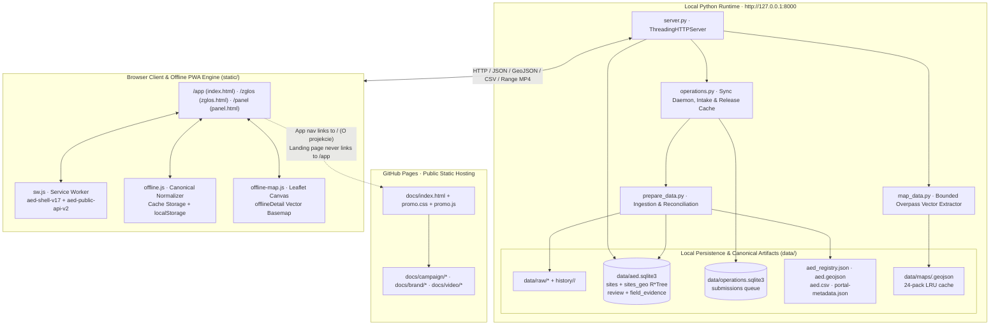
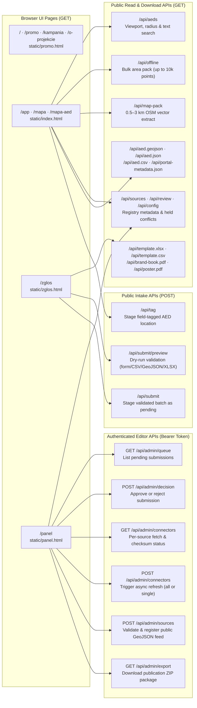
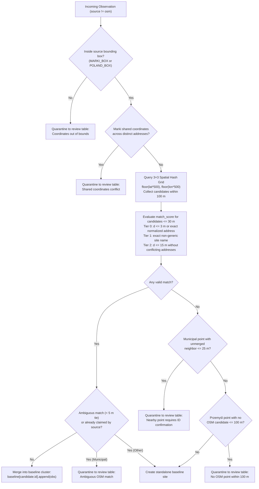
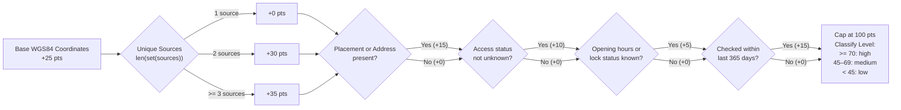
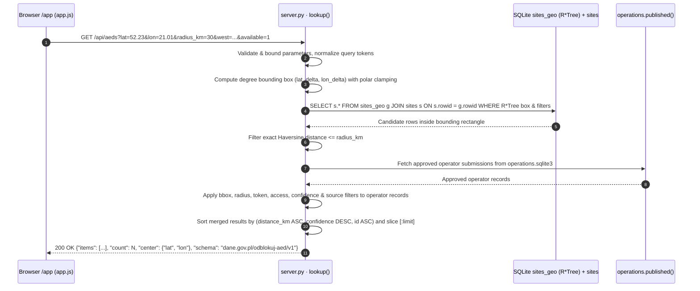
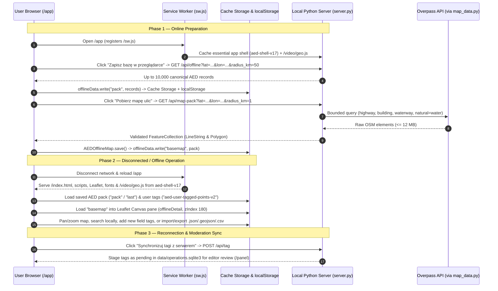

# Serce Okolicy · Odblokuj AED

**Serce Okolicy · Odblokuj AED** is an open-data Automated External Defibrillator (AED) aggregation pipeline, spatial registry, offline-capable Progressive Web App (PWA), organization contribution intake, and authenticated editor governance platform built for the **Misja AED** (`dane.gov.pl`) challenge.

The project separates its **public campaign landing page** (deployed as a static bundle to **GitHub Pages**) from its **offline-capable Python + SQLite R\*Tree application** (which runs locally without cloud dependencies):

- **Published Campaign Landing Page (GitHub Pages):** [`https://rodrigogaluppo.github.io/HACK_NATION_Serce_Okolicy/`](https://rodrigogaluppo.github.io/HACK_NATION_Serce_Okolicy/)
  - Self-contained static bundle served from [`docs/`](docs/index.html) (and mirrored to the `gh-pages` branch).
  - Contains **no links to the local application routes** (`/app`, `/zglos`, `/panel`) because the application runs offline/locally rather than on GitHub Pages.
- **Local Python Application & Offline PWA (`http://127.0.0.1:8000`):**
  - Runs locally via [`server.py`](server.py) on top of [`prepare_data.py`](prepare_data.py), [`operations.py`](operations.py), and [`map_data.py`](map_data.py).
  - Navigation headers inside the local app (`/app`, `/zglos`, `/panel`) link back to `/` (**O projekcie** / campaign landing page), while the landing page remains strictly self-contained.
  - Full **PL / EN** bilingual switching is built into the landing page, the interactive map PWA, the contribution intake screen, and the editor workspace.

**See the product in use:** [map, offline tools and data-panel screenshots](#product-screenshots).

## Standalone LoRa device prototypes

[`Lora/`](Lora/README.md) contains isolated Heltec V3 sender/receiver firmware, a hardcoded Bydgoszcz AED snapshot, a CYD nearest-location list, and a T-Watch 2020 V1 MicroPython interface with a Python loader. The displays receive LoRa locations through a Heltec bridge; distances use an explicitly labeled fixed reference, not GPS. See its README for exact hardware, wiring, flashing, data provenance and tests. This optional folder does not change the running server, PWA or data pipeline.

---

## 1. System Architecture & Deployment Topology



---

## 2. Quick Start & Running Locally

### Prerequisites
- **Python 3.10+** compiled with SQLite **R\*Tree** spatial index support (`sqlite3` standard library module).
- [`openpyxl`](requirements.txt) for generating and validating multi-sheet `.xlsx` contribution workbooks.
- **Node.js 18+** *(optional, for running client-side offline unit tests and Playwright browser checks)*.

### Installation & Startup

```sh
python3 -m venv .venv
.venv/bin/python -m pip install -r requirements.txt

# 1. Fetch live upstream sources, validate checksums, reconcile entities, and build SQLite R*Tree + canonical files
.venv/bin/python prepare_data.py --refresh

# 2. Start the local multi-threaded HTTP server and 24-hour background sync scheduler
.venv/bin/python server.py --host 127.0.0.1 --port 8000
```

- **Rebuild offline from cached snapshots:** If you have already fetched snapshots into `data/raw/`, run `.venv/bin/python prepare_data.py` (without `--refresh`) to rebuild `data/aed.sqlite3` and canonical files completely offline.
- **Admin authentication token:** On first launch, [`operations.admin_token()`](operations.py#L74-L86) generates a cryptographically random 24-byte URL-safe token in `data/admin-token` (permissions `0600`) unless `AED_ADMIN_TOKEN` is set in the environment. Copy this token into `/panel` to unlock administrative actions.
- **Environment variables:**
  - `AED_ADMIN_TOKEN` — Override the local file-based editor bearer token.
  - `AED_SYNC_INTERVAL_HOURS` — Background refresh cadence in hours (defaults to `24`, minimum `1`).
  - `WARSAW_API_TOKEN` — Enables live fetching from the City of Warsaw SCB defibrillator endpoint (`get_scb_lokalizacja_defibrylatorow`).
  - `GOOGLE_MAPS_BROWSER_KEY` & `GOOGLE_MAPS_MAP_ID` — Optional browser key to enable the online Google Maps layer switch inside `/app`.

---

## 3. Repository Structure & Codebase Guide

Every module in the repository has a focused responsibility with zero framework bloat:

```text
.
├── prepare_data.py              # Multi-source HTTPS fetcher, normalizer, spatial grid reconciler & SQLite/JSON/CSV builder
├── operations.py                # 24h sync scheduler, XLSX/CSV/GeoJSON intake validator, moderation queue & ZIP exporter
├── map_data.py                  # Rate-limited Overpass API vector extractor (0.5–3 km street/building/water GeoJSON packs)
├── server.py                    # ThreadingHTTPServer, spatial R*Tree + token search engine, REST API & Range video streamer
├── requirements.txt             # Python dependency specification (openpyxl)
├── scripts/
│   └── extract-campaign.cjs     # Helper script for extracting campaign visual assets
├── static/
│   ├── promo.html               # Campaign landing page (served at /, /promo, /kampania, /o-projekcie)
│   ├── promo.css                # Campaign landing page styles and before/after map comparison slider layout
│   ├── promo.js                 # Landing page PL/EN translation switcher and comparison slider controller
│   ├── index.html               # Offline-capable AED Map PWA workspace (served at /app, /mapa, /mapa-aed)
│   ├── app.js                   # Map controller, viewport queries, filters, field tagging modal & offline pack manager
│   ├── app-i18n.js              # Runtime PL/EN dictionary and DOM translator for the map application
│   ├── app.css                  # Map workspace, filter popover, confidence badge & modal dialog styles
│   ├── styles.css               # Shared design system tokens, typography, masthead & responsive layout
│   ├── offline.js               # Client-side canonical schema normalizer, CSV/GeoJSON/JSON parser & Cache/localStorage API
│   ├── offline-map.js           # Leaflet Canvas offline street/building vector renderer & geometry validator
│   ├── sw.js                    # Service Worker (aed-shell-v17 + bounded 80-entry public API cache)
│   ├── zglos.html               # Single-device & bulk (XLSX/CSV/GeoJSON) contribution intake screen (served at /zglos)
│   ├── panel.html               # Token-authenticated editor governance & data pipeline workspace (served at /panel)
│   ├── office.js                # Client controller for /zglos (preview/submit) and /panel (queue, sync, register source)
│   ├── office.css               # Styles for contribution forms, pipeline diagram, connector cards & review queue
│   ├── przyklad.geojson         # Sample GeoJSON file for testing bulk contribution intake
│   ├── manifest.webmanifest     # PWA install manifest (icons, theme colors, standalone display mode)
│   ├── brand/                   # Local fonts (Atkinson Hyperlegible, Outfit, Roboto, DM Sans, Bebas Neue) + logos & OFL licenses
│   ├── campaign/                # Visual assets for the campaign landing page (before/after Poland maps, Bydgoszcz route, LoRa, icons)
│   └── vendor/                  # Self-hosted Leaflet 1.9.4 JS/CSS and simplified Poland boundaries GeoJSON
├── video/
│   ├── geo.js                   # Offline vector reference geometry for Poland voivodeships/rivers/cities
│   ├── street_heart_logo.png    # Application masthead brand emblem
│   ├── Serce-Okolicy-cover.jpg  # Campaign film poster frame
│   └── Serce-Okolicy-v4.mp4     # 90-second campaign film served with HTTP 206 byte-range streaming
├── docs/                        # Standalone GitHub Pages static bundle (index.html, promo.css, promo.js, brand/, campaign/, video/)
├── .github/workflows/pages.yml  # GitHub Actions workflow deploying docs/ to GitHub Pages on push to main
└── tests/
    ├── test_data_pipeline.py    # Python unit tests for reconciliation, provenance, catalogue discovery & release caching
    ├── test_map_data.py         # Python unit tests for Overpass vector conversion & geographic bounds validation
    ├── offline.test.cjs         # Node.js VM tests for client-side canonical normalization, CSV injection guard & roundtrips
    ├── offline-map.test.cjs     # Node.js VM tests for offline vector basemap validation & coordinate bounds
    └── browser.mjs              # Playwright end-to-end desktop/mobile & offline reload verification suite
```

### Core Backend Modules
1. **[`prepare_data.py`](prepare_data.py)**
   - Defines the 30 canonical `dane.gov.pl` schema fields (`FIELDS`), source catalogue (`SOURCES`), licensing metadata (`SOURCE_METADATA`), and municipal TERYT codes (`TERYT_MAP`).
   - Implements [`public_download()`](prepare_data.py#L176-L196) to enforce HTTPS-only downloads, reject credentials/non-443 ports, and resolve DNS on every hop (including HTTP redirects) to block private, loopback, or link-local IP addresses (SSRF protection).
   - Discovers the newest `csv` or `geojson` resource in `dane.gov.pl` datasets via [`catalogue_resource()`](prepare_data.py#L199-L216), filtering out non-AED resources in mixed municipal datasets.
   - Scrapes InPost AED locker codes and resolves their coordinates concurrently via the ShipX API (`ThreadPoolExecutor(max_workers=12)`) in [`refresh_inpost()`](prepare_data.py#L491-L550), retaining previous observations if individual locker lookups fail.
   - Normalizes diacritics, strips PII/secrets (`PRIVATE_TEXT`), reconciles duplicates across sources (`reconcile`), scores evidence (`compute_confidence`), and atomically builds `data/aed.sqlite3` (with `sites_geo` R\*Tree and `field_evidence` audit table) alongside `aed_registry.json`, `aed.geojson`, `aed.csv`, and `portal-metadata.json`.
2. **[`operations.py`](operations.py)**
   - Runs a daemon thread ([`start_daily_scheduler()`](operations.py#L199-L218)) that checks `RUN["next_sync_at"]` every 30 seconds and triggers an asynchronous multi-source refresh (`start_refresh("all")`) every `AED_SYNC_INTERVAL_HOURS`.
   - Manages `data/operations.sqlite3` (`submissions` table) for pending/approved/rejected community tags and organizational uploads.
   - Validates single-form, CSV, GeoJSON, and 4-sheet XLSX uploads ([`input_rows()`](operations.py#L230-L288), [`validate()`](operations.py#L291-L366)) up to 500 devices per batch.
   - Generates the 4-worksheet reference template (`Dane_AED`, `Slownik_pol`, `Wartosci`, `Przyklady`) in [`xlsx_template()`](operations.py#L671-L728).
   - Maintains an in-memory release cache ([`public_release_files()`](operations.py#L642-L658)) keyed by `(path, st_mtime_ns, st_size)` of the underlying SQLite and JSON files so `/api/aed.geojson`, `/api/aed.csv`, `/api/aed.json`, and `/api/admin/export` always serve a consistent, merged snapshot of baseline + approved operator records.
3. **[`map_data.py`](map_data.py)**
   - Provides [`extract(lat, lon, radius)`](map_data.py#L45-L87) and [`convert()`](map_data.py#L18-L42) to fetch user-requested 0.5–3 km vector street/building/water extracts from the Overpass API (`way[highway]`, `way[building]`, `way[waterway]`, `way[natural=water]`).
   - Enforces a strict 15-second global cooldown between upstream Overpass requests, a non-blocking mutex (`LOCK`), a 12 MB upstream payload ceiling, a 30,000-feature cap, and a 24-file LRU disk cache (`data/maps/<sha256>.geojson`) with a 30-day TTL.
4. **[`server.py`](server.py)**
   - Implements [`lookup(db, params, offline=...)`](server.py#L64-L191) combining SQLite R\*Tree spatial bounding queries, Haversine distance filtering, viewport bounding boxes (`west`, `south`, `east`, `north`), token-based diacritic-insensitive text search, confidence thresholds, and live merging with approved operator records.
   - Serves all HTML pages, static assets, HTTP `206 Partial Content` byte-range video streams, public data exports, intake endpoints, and Bearer-authenticated admin endpoints.

---

## 4. Complete Route Reference & How to Use Every Endpoint



### 4.1 HTML Application & Campaign Routes (`GET`)

| Route | Underlying File | Purpose & How to Use It |
| --- | --- | --- |
| `/`, `/promo`, `/kampania`, `/o-projekcie` | [`static/promo.html`](static/promo.html) | **Campaign Landing Page.** Switch between **PL** and **EN** in the top bar, watch the 90-second campaign film (`/video/Serce-Okolicy-v4.mp4`), drag the interactive before/after data consolidation slider, review the 112/CPR/3–5 minute emergency protocol, explore the LoRa/Meshtastic radio concept, and read the battery replacement support proposal. Contains no links to `/app`, `/zglos`, or `/panel`. |
| `/app` | [`static/index.html`](static/index.html) | **Interactive AED Map & Offline PWA.** Search by city/address/venue, click city quick-chips (*Warszawa, Bydgoszcz, Kraków, Gdańsk*), pan/zoom with live viewport updates, filter by source, confidence threshold ($\ge 45$, $\ge 70$), or public access, inspect per-field source provenance, tag new AED locations on the map, or open **Twoja mapa offline** to save AED records and a 0.5–3 km vector street basemap for offline use. |
| `/mapa`, `/mapa-aed` | [`static/index.html`](static/index.html) | **Map-First Aliases for `/app`.** Used by the **Pełny ekran** (Full screen) control and direct map bookmarks; cached identically by the Service Worker (`sw.js`). |
| `/zglos` | [`static/zglos.html`](static/zglos.html) | **Contribution & Inventory Intake Screen.** Download the 4-sheet `.xlsx` template, `.csv` template, or sample `.geojson`. Choose between submitting a **single device** via the form or uploading a **batch file** (`.xlsx`, `.geojson`, `.csv`, up to 500 rows / 1.6 MB). Click **Sprawdź dane** (*Preview data*) to run server-side validation and inspect row-level errors before **Wyślij do zatwierdzenia** (*Send for review*) becomes enabled. |
| `/panel` | [`static/panel.html`](static/panel.html) | **Authenticated Editor Workspace.** Paste the local token from `data/admin-token` (or `AED_ADMIN_TOKEN`). View live source metrics, visual data-flow pipeline, per-source snapshot timestamps and SHA-256 status, trigger manual synchronization (**Synchronizuj teraz**), inspect and **Approve / Reject** pending submissions, inspect quarantined conflicts, connect new public HTTPS GeoJSON feeds, and export the `dane.gov.pl` publication ZIP package. |

#### Product screenshots

These screenshots show the local application on **22 November 2026**. Counts, selected records and synchronization times describe that captured session; they are not live registry totals. Open `/app` or `/panel` on your running local server to follow the same workflows. Click an image to inspect its full-size capture.

##### AED map — `/app`

**Find nearby AED locations in Bydgoszcz.** The map and **W pobliżu** list present the same search area, with distances, cabinet-location descriptions, evidence-confidence badges and reported opening hours. This capture shows a 5 km search radius and 78 results. Use the search field, city shortcuts or **Moja lokalizacja** to choose an area; with **Szukaj przy przesuwaniu** checked, moving the map updates the search. The colored markers help distinguish evidence quality across the results.


**Filter for stronger evidence and inspect a selected record.** The **Filtry mapy** menu is open with **Wysoka (≥70)** selected, leaving one result in this captured search. Selecting **Bydgoszcz Główna – Punkt Weryfikacji PWA** opens matching details in the sidebar and marker popup: reported public access, 24/7 hours, cabinet placement, verification dates and source attribution. **Proweniencja pól** expands field-level provenance, while **Oznacz / popraw dane** starts a correction and **GeoJSON punktu** exports the selected record. The 70/100 score describes the evidence; the device's readiness is still explicitly **unknown**.


**Compare a record with incomplete verification.** Changing the evidence filter to **Średnia i wysoka (≥45)** shows 55 results in this capture. The selected OSM record scores 55/100 and reports restricted access and opening hours, but has no recorded check dates for location, access or readiness. Keeping those unknowns visible helps users interpret the information instead of treating every map marker as an equally verified device.


**See where the data comes from and download it.** Clicking **Źródła danych** opens **Źródła mapy** over the map. Source cards identify the contributing datasets, observation counts, geographic scope, update schedules, licenses and upstream links. The download buttons provide the combined registry as GeoJSON, JSON or CSV, alongside publication metadata and the XLSX template. This makes the map's underlying data available for inspection and reuse.


**Prepare an offline map and move data between devices.** **Twoja mapa offline** separates saving nearby AED records from downloading a small street-and-building basemap. Here the AED-pack radius is set to 50 km, the browser reports one saved registry point and no local tags, and no detailed street map has been downloaded yet. The lower card offers a separate 0.5 km street-map download. The other controls export or import JSON, GeoJSON and CSV, export local tags, and send tags to the server for review. Importing a file into the browser does not publish it to the shared registry; detailed offline streets must be downloaded separately before they can be used without a connection.


##### Data and editor workspace — `/panel`

**Follow the data from its sources to the public map.** The panel overview shows seven active sources, 18,574 source observations, no pending submissions and 23 records requiring verification in this session. The green **Od źródła do mapy** diagram connects source feeds to normalization, merging and checks, then to the map and GeoJSON/JSON/CSV exports. **Synchronizuj teraz** requests a refresh; individual source rows below expose fetch times, formats, licenses and connector status. An inactive source is shown as inactive rather than presented as a working feed. Source observations are inputs to reconciliation, so their count differs from the final number of map locations.


**Review submissions and keep unresolved records out of the public map.** Further down the panel, **Zgłoszenia do zatwierdzenia** is empty in this capture, while **Wymagają sprawdzenia** lists unresolved cases. Examples include a procurement lead that does not establish an installed AED, nearby records needing identity checks, and conflicting addresses sharing coordinates. Editors use this separation to avoid publishing uncertain locations automatically. **Pakiet publikacyjny ZIP** exports a publication package, and **Nowe źródło** provides paths to submit a file or location and connect a public GeoJSON feed. Editor actions require the local administrator token described in the route reference below.


<details>
<summary>Additional capture of the review queue and source controls</summary>

This earlier capture shows the same panel state, including the approved PWA contribution source above the empty submission queue. The desktop's “Screenshot captured” notification covers part of the header; the unobstructed version is shown above.


</details>

---

### 4.2 Public Query & Offline Basemap API Routes (`GET`)

#### `GET /api/aeds` — Spatial, Viewport & Full-Text AED Lookup
Queries the SQLite R\*Tree spatial index (`sites_geo`), normalized full-text search column (`search_text`), and approved operator submissions.

| Query Parameter | Type / Bounds | Default | Description |
| --- | --- | --- | --- |
| `q` | `string` (0–100 chars) | `""` | Search query. If `q` matches a known city slug (`warszawa`, `krakow`, `bydgoszcz`, `gdansk`, `trojmiasto`, `krosno`, `przemysl`, `marki`, etc.) and `lat`/`lon` are omitted, centers the spatial search on that city; otherwise performs diacritic-insensitive token matching across name, address, municipality, placement, operator, and postcode. |
| `lat`, `lon` | `float` (`[-90, 90]`, `[-180, 180]`) | `52.2297`, `21.0122` | Center coordinates for radial search (must be provided together). |
| `radius_km` | `float` (`0.1`–`600`) | `30` | Search radius in kilometers around `(lat, lon)`. |
| `west`, `south`, `east`, `north` | `float` (valid bbox) | *none* | Viewport bounding box filter (`west < east`, `south < north`). All four must be supplied together when filtering by map viewport. |
| `available` | `"1"` or `"0"` | `"0"` | When `"1"`, filters to records with public access (`access_type == "public"`). |
| `min_confidence` | `int` (`0`–`100`) | `0` | Minimum evidence confidence score (e.g., `45` for medium+, `70` for high). |
| `source` | `string` | `""` | Filter records by source identifier (e.g., `osm`, `krosno`, `przemysl`, `marki`, `inpost`, `legionowo`, or `operator_<hash>`). |
| `limit` | `int` (`1`–`10000`, capped at `120`) | `60` | Maximum number of records returned (`MAX_LIMIT = 120` for online `/api/aeds` requests). |

**Example:**
```sh
curl -s "http://127.0.0.1:8000/api/aeds?q=bydgoszcz&radius_km=15&available=1&min_confidence=45&limit=10" | python3 -m json.tool
```

#### `GET /api/offline` — Bulk Area Pack Download for Offline PWA
Identical filtering semantics to `/api/aeds`, except:
- `lat` and `lon` are **mandatory** (`400 Bad Request` if omitted).
- Returns up to **10,000 records** (`limit = 10000`) within `radius_km` (up to `600 km`) so the browser can store an entire city or region in `Cache Storage` (`aed-saved-points-v2`).

**Example:**
```sh
curl -s "http://127.0.0.1:8000/api/offline?lat=53.1235&lon=18.0084&radius_km=50" | python3 -m json.tool | head -n 30
```

#### `GET /api/map-pack` — Bounded Overpass Street & Building Vector Extract
Downloads a local vector GeoJSON basemap (`LineString` roads/waterways and `Polygon` buildings/water) around a point in Poland for offline Canvas rendering.
- **Parameters:**
  - `lat` (`48.9`–`55.0`, default `52.2297`)
  - `lon` (`14.0`–`24.2`, default `21.0122`)
  - `radius_km` (`0.5`–`3.0`, default `1.0`)
- **Guards:** Enforces Poland bounding box, 15s rate limit between live Overpass queries, 12 MB response limit, 30,000 feature limit, and 30-day disk cache in `data/maps/`.

**Example:**
```sh
curl -s "http://127.0.0.1:8000/api/map-pack?lat=52.2297&lon=21.0122&radius_km=1" -o warszawa-1km.map.geojson
```

#### `GET /api/sources`, `GET /api/review`, `GET /api/config`
- `GET /api/sources` — Returns active imported sources (with record counts, license metadata, and URLs), approved operator sources, `planned_source_count`, `storage_engine`, `sync_schedule`, `next_sync_at`, total `site_count`, `review_count`, and `generated_at`.
- `GET /api/review` — Returns up to 200 quarantined records and procurement leads held out of the public registry (`source`, `ref`, `name`, `reason`, `address`).
- `GET /api/config` — Returns runtime client configuration (`google_maps_key`, `google_maps_map_id`, `mode`, `sync_schedule`, `next_sync_at`).

---

### 4.3 Public Dataset, Template & Brand Download Routes (`GET`)

| Route | Content-Type / Attachment Filename | Description |
| --- | --- | --- |
| `GET /api/aed.geojson` | `application/geo+json` (`aed.geojson`) | RFC 7946 `FeatureCollection` of all located AEDs (baseline + approved operator submissions) with `[longitude, latitude]` coordinates and all canonical properties. |
| `GET /api/aed.json` | `application/json` (`aed.json`) | Canonical JSON registry (`schema: "dane.gov.pl/odblokuj-aed/v1"`) including metadata, source inventory, and full `items` array (both `located` and `address_only` records). |
| `GET /api/aed.csv` | `text/csv; charset=utf-8` (`aed.csv`) | RFC 4180 UTF-8 CSV with `CRLF` line endings, 30 canonical columns, JSON-encoded `source_ids`/`field_sources`, and formula-injection escaping. |
| `GET /api/portal-metadata.json` | `application/json` (`portal-metadata.json`) | Draft `dane.gov.pl` DCAT/portal descriptor with SHA-256 checksums, record counts, effective `data_date`, and per-source license status. |
| `GET /api/template.xlsx` | `application/vnd.openxmlformats-officedocument.spreadsheetml.sheet` (`wzorcowy-zakres-aed.xlsx`) | 4-worksheet Excel template (`Dane_AED`, `Slownik_pol`, `Wartosci`, `Przyklady`) dynamically generated by `operations.xlsx_template()`. |
| `GET /api/template.csv` | `text/csv; charset=utf-8` (`wzorcowy-zakres-aed.csv`) | 16-column header row matching the `INTAKE` contribution contract. |
| `GET /api/brand-book.pdf` | `application/pdf` | Streams `pdf/brand-book.pdf` from `Odblokuj-AED-identyfikacja.zip` when present in the local checkout. |
| `GET /api/poster.pdf` | `application/pdf` | Streams `pdf/poster.pdf` from `Odblokuj-AED-identyfikacja.zip` when present in the local checkout. |
| `GET /api/identyfikacja.zip` | `application/zip` | Downloads the complete brand identity archive when present in the local checkout. |
| `GET /video/<filename>` | `video/mp4`, `image/jpeg`, `application/javascript`, etc. | Serves campaign video and vector assets from `video/` with full **HTTP Range (`206 Partial Content`)** support for seeking in HTML5 `<video>`. |

---

### 4.4 Public Contribution & Field Tagging Routes (`POST`)

All `POST` endpoints expect `Content-Type: application/json` with a payload up to `2.5 MB`.

#### `POST /api/submit/preview` & `POST /api/submit`
- **`/api/submit/preview`** validates the submission batch and returns `{"valid": <count>, "errors": [{"row": <n>, "message": "..."}], "sample": [...]}` without writing to the database.
- **`/api/submit`** runs the same validation; if `errors` is empty, stages the records in `data/operations.sqlite3` with `status = 'pending'` and returns `201 Created` (`{"accepted": <count>}`).

**Example (`curl` single-device submission preview & submit):**
```sh
curl -s -X POST http://127.0.0.1:8000/api/submit/preview \
  -H "Content-Type: application/json" \
  -d '{
    "operator": "Biblioteka Miejska Bydgoszcz",
    "consent": true,
    "format": "form",
    "data": {
      "operator_device_id": "BMB-01",
      "site_name": "Biblioteka Główna",
      "municipality": "Bydgoszcz",
      "street": "Stary Rynek",
      "house_number": "24",
      "postcode": "85-105",
      "longitude": "18.0003",
      "latitude": "53.1221",
      "placement": "Hol wejściowy na parterze po lewej stronie",
      "level": "parter",
      "cabinet_lock_status": "unlocked",
      "access_instructions": "Wejście główne od Starego Rynku",
      "access_type": "public",
      "opening_hours": "Mo-Fr 08:00-20:00; Sa 09:00-15:00",
      "location_checked_on": "2026-11-21",
      "access_checked_on": "2026-11-21"
    }
  }' | python3 -m json.tool
```

#### `POST /api/tag`
Stages a field-tagged AED location created in the `/app` map modal (or synced from offline PWA `localStorage`). Always enters the moderation queue as `pending` (`auto_approve=False`).

```sh
curl -s -X POST http://127.0.0.1:8000/api/tag \
  -H "Content-Type: application/json" \
  -d '{
    "site_name": "Dworzec Bydgoszcz Główna",
    "municipality": "Bydgoszcz",
    "latitude": 53.1338,
    "longitude": 18.0009,
    "placement": "Hol główny przy kasach biletowych",
    "access_type": "public",
    "cabinet_lock_status": "unlocked",
    "opening_hours": "24/7",
    "user_confidence": 95
  }' | python3 -m json.tool
```

---

### 4.5 Authenticated Editor & Governance API Routes (`/api/admin/*`)

All `/api/admin/*` endpoints verify `Authorization: Bearer <token>` using constant-time comparison ([`secrets.compare_digest`](server.py#L230-L234)) against `data/admin-token` (or `AED_ADMIN_TOKEN`). Unauthorized requests receive `401 Unauthorized`.

| Method & Route | Request Body | Response & Behavior |
| --- | --- | --- |
| `GET /api/admin/queue` | *none* | Returns up to 500 pending submissions (`{"items": [{"id", "created", "status", "payload"}]}`). |
| `POST /api/admin/decision` | `{"id": "<submission_id>", "status": "approved" \| "rejected"}` | Transitions a `pending` submission to `approved` or `rejected`. Once approved, the record immediately joins `/api/aeds`, `/api/aed.geojson`, `/api/aed.csv`, `/api/aed.json`, and `/api/admin/export` under its own `operator_<sha256>` source identity. |
| `GET /api/admin/connectors` | *none* | Returns `run` scheduler state (`idle`/`running`/`complete`/`failed`, `finished_at`, `next_sync_at`, `results`) and all configured, awaiting-adapter, and approved-operator sources. |
| `POST /api/admin/connectors` | `{"source": "all" \| "<source_id>"}` | Starts an asynchronous background refresh worker for all live sources or a specific source (`202 Accepted`, or `409 Conflict` if a sync is already running). |
| `POST /api/admin/sources` | `{"name": "...", "url": "https://...", "license": "...", "scope": "..."}` | Downloads and validates a public HTTPS GeoJSON `FeatureCollection` (must contain `Point` geometries in Poland with unique stable IDs), persists it to `data/source-config.json`, archives its SHA-256 snapshot, and rebuilds the SQLite registry (`201 Created`). |
| `GET /api/admin/export` | *none* | Downloads `odblokuj-aed-pakiet-portalu.zip` containing `aed.csv`, `aed.geojson`, `aed.json`, `portal-metadata.json`, and `wzorcowy-zakres-aed.xlsx`. |

**Example (`curl` admin workflow):**
```sh
TOKEN=$(cat data/admin-token)

# 1. Inspect pending submissions
curl -s -H "Authorization: Bearer $TOKEN" http://127.0.0.1:8000/api/admin/queue | python3 -m json.tool

# 2. Approve a submission by ID
curl -s -X POST http://127.0.0.1:8000/api/admin/decision \
  -H "Authorization: Bearer $TOKEN" \
  -H "Content-Type: application/json" \
  -d '{"id": "<submission_id>", "status": "approved"}'

# 3. Export the complete dane.gov.pl publication ZIP
curl -s -H "Authorization: Bearer $TOKEN" http://127.0.0.1:8000/api/admin/export -o pakiet-portalu.zip
```

---

## 5. Core Algorithms Explained in Detail

### 5.1 Spatial Grid Hashing & Multi-Source Entity Reconciliation (`prepare_data.py`)

When combining national crowd-sourced data (OpenAEDMap / OpenStreetMap) with municipal open-data catalogues (*Krosno*, *Przemyśl*, *Marki*, *Legionowo*) and commercial operator networks (*InPost*), simply concatenating files creates duplicate pins and hides coordinate defects. Conversely, naive $O(N^2)$ pairwise comparison across $>15,000$ records is slow.

[`prepare_data.reconcile()`](prepare_data.py#L661-L727) solves this in $O(N)$ expected time using a **spatial hash grid** combined with a **3-tier deterministic matching hierarchy** and **quarantine rules**:

1. **Spatial Grid Indexing (`grid_cell`):**
   Every baseline OSM observation is bucketed into a discrete grid cell:
   $$\text{cell}(\phi, \lambda) = \left(\lfloor 500 \cdot \phi \rfloor,\; \lfloor 500 \cdot \lambda \rfloor\right)$$
   Each cell spans $0.002^\circ \times 0.002^\circ$ ($\approx 222\text{ m}$ in latitude and $\approx 136\text{ m}$ in longitude at Poland's latitude $\phi \approx 52^\circ$).
2. **$3 \times 3$ Neighborhood Candidate Lookup:**
   For each incoming non-OSM observation, only candidates in the $3 \times 3$ surrounding grid cells $(r \pm 1, c \pm 1)$ are inspected. Exact separation is computed via the **Haversine formula** ([`distance()`](prepare_data.py#L317-L321)):
   $$d = 2R \arcsin\left(\sqrt{\min\left(1,\; \sin^2\frac{\Delta\phi}{2} + \cos\phi_1\cos\phi_2\sin^2\frac{\Delta\lambda}{2}\right)}\right), \quad 2R = 12742\text{ km}$$
   Candidates within $d \le 0.100\text{ km}$ ($100\text{ m}$) are collected into `nearby`.
3. **Coordinate Axis Inversion Auto-Repair & Defect Quarantine:**
   - **Marki Axis Swap Detection:** In [`parse_csv()`](prepare_data.py#L459-L461), if a Marki record fails `in_box(lat, lon, MARKI_BOX)` where `MARKI_BOX = (52.30, 52.40, 21.06, 21.20)` but passes `in_box(lon, lat, MARKI_BOX)`, the adapter swaps $(\text{lat}, \text{lon}) \leftrightarrow (\text{lon}, \text{lat})$ and records `transformation = "zamiana osi (walidacja granic miasta Marki)"` in `field_evidence`.
   - **Out-of-Bounds Quarantine:** If a coordinate still falls outside `MARKI_BOX` (for Marki, e.g., the *School No. 5* record whose coordinates point to Krosno) or `POLAND_BOX = (49.0, 55.0, 14.0, 24.3)`, the record is routed to the `review` table and excluded from the public map.
   - **Duplicate Coordinate Quarantine (Marki):** If multiple distinct addresses in Marki share identical `(lat, lon)` coordinates (`marki_coords[lat, lon] > 1`), they are held in `review`.
   - **Legionowo Deterministic Hashing:** Because Legionowo's municipal CSV (`dane.gov.pl #40593`) lacks a device ID column and places distinct devices at the same municipal building coordinates (e.g., Police and Municipal Guard at *Jagiellońska 26*), [`parse_csv()`](prepare_data.py#L440-L445) computes a deterministic 24-character SHA-256 prefix over normalized `nazwa|miejscowosc|nazwa_ulicy|nr_budynku|nr_lokalu` so co-located devices remain distinct entities.
4. **3-Tier Match Scoring (`match_score`) within $30\text{ m}$ ($d \le 0.030\text{ km}$):**
   - **Score `0` (Highest priority):** $d \le 3\text{ m}$ ($0.003\text{ km}$) **OR** both observations have non-empty normalized street addresses that match identically (`normalize(obs.address) == normalize(cand.address)`).
   - **Score `1` (Specific name match):** Normalized site names match (`normalize(obs.name) == normalize(cand.name)`) and the name is not a generic placeholder (`{"defibrylator aed", "defibrylator", "aed"}`).
   - **Score `2` (Close proximity fallback):** $d \le 15\text{ m}$ ($0.015\text{ km}$) and at least one of the two records lacks a street address.
   - **No match (`None`):** Candidate is private (`access in {"private", "no"}`) or none of the tiers apply.



---

### 5.2 Field-Level Provenance Selection & Privacy Scrubbing (`canonical_record`)

When multiple observations `[primary, *support]` are merged into a single AED cluster, [`canonical_record()`](prepare_data.py#L730-L843) resolves each attribute independently and records which source provided which field:

- **Authority Ranking by Field Category:**
  - For descriptive and administrative fields (`name`, `address`, `municipality`, `street`, `house_number`, `postcode`, `placement`, `cabinet_lock_status`, `access_instructions`, `operator`), municipal/operator support observations take priority over baseline OSM: `ranked = [*support, primary]`.
  - For coordinates and baseline tags (`access`, `hours`, `checked_on`, `level`, `indoor_outdoor`), the primary observation takes priority: `ranked = [primary, *support]`.
- **Per-Field Provenance Audit:**
  - `source_ids` preserves the ordered list of unique contributing sources (e.g., `["osm", "krosno"]`).
  - `field_sources` maps every populated canonical attribute (e.g., `"coordinates": "osm"`, `"placement": "krosno"`, `"street": "krosno"`) to the exact source that supplied its value.
  - The SQLite `field_evidence` table stores `(aed_id, field, source, upstream_id, transformation)` for every field of every record.
- **Automated PII & Secret Scrubbing (`PRIVATE_TEXT`):**
  - Every public text field passes through [`public_text()`](prepare_data.py#L276-L279), which strips email addresses, Polish phone numbers (`+48 XXX XXX XXX`), and cabinet PIN codes (`kod dostępu: 1234`, `PIN: 9999`).
- **Strict Epistemic Honesty (`unknown` vs. `ready`):**
  - `readiness_status` always defaults to `"unknown"` unless verified readiness evidence is explicitly supplied. Merging multiple sources or refreshing a dataset never implies that a device's battery or electrode pads are functional.
  - `is_stale` is set to `True` whenever `location_checked_on` or `access_checked_on` is older than **365 days** (and future dates are rejected/cleared).

---

### 5.3 Evidence Confidence Scoring Algorithm (`compute_confidence`)

Each record receives a transparent evidence score (`0–100`) and level (`low`, `medium`, `high`) computed by [`compute_confidence()`](prepare_data.py#L629-L658). The score measures **documentation completeness and multi-source corroboration**, never physical device readiness:



| Evidence Criterion | Points Added | Explanation Appended to `confidence_reasons` |
| --- | --- | --- |
| Base WGS84 coordinates | **`+25`** | `"Źródło zawiera współrzędne WGS84; nie jest to kontrola w terenie"` |
| Matched across 2 sources | **`+30`** | `"Dopasowanie rekordów co najmniej dwóch źródeł"` |
| Matched across $\ge 3$ sources | **`+35`** *(replaces +30)* | `"Dopasowane rekordy z N źródeł; niezależność wymaga oceny"` |
| Detailed `placement` or `address` | **`+15`** | `"Szczegółowy opis lokalizacji szafki lub pełny adres"` |
| Explicit `access_type` (`public`/`restricted`) | **`+10`** | `"Określony status dostępności publicznej"` |
| Known `opening_hours` or `cabinet_lock_status` | **`+5`** | `"Informacja o godzinach dostępu lub stanie zamka szafki"` |
| `checked_on` within $0 \le \text{age} \le 365$ days | **`+15`** | `"Potwierdzona data weryfikacji z ostatnich 365 dni"` |
| **Total Score Range** | **`25` – `100`** | **`high`** ($\ge 70$), **`medium`** ($45\text{–}69$), **`low`** ($< 45$) |

---

### 5.4 Hybrid Spatial Lookup Engine with SQLite R\*Tree (`server.py`)

Why use **both** canonical JSON/GeoJSON/CSV files and SQLite?
- **JSON/GeoJSON/CSV** are portable interchange formats ideal for `dane.gov.pl` publication, bulk downloads, and offline PWA snapshots.
- **SQLite R\*Tree (`sites_geo`)** enables sub-millisecond bounding-box queries without scanning all 15,299+ national records on every map pan.



---

### 5.5 Offline PWA Lifecycle & Vector Basemap Canvas Renderer (`offline.js`, `offline-map.js`, `sw.js`)

The application is engineered to remain functional when internet connectivity is completely lost:



Key technical details of the offline engine:
- **Zero Tile Scraping:** Standard OpenStreetMap raster tile servers forbid bulk tile downloading. Instead, `AEDOfflineMap` ([`static/offline-map.js`](static/offline-map.js)) combines a built-in simplified national vector reference map ([`video/geo.js`](video/geo.js) + [`static/vendor/boundaries.geojson`](static/vendor/boundaries.geojson)) with user-requested 0.5–3 km Overpass vector packs rendered on an HTML5 `<canvas>` layer (`L.canvas({pane: "offlineDetail"})`).
- **Greedy Screen-Space Label Collision Avoidance:** At zoom levels $\ge 15$, [`static/offline-map.js`](static/offline-map.js#L43-L52) projects road midpoints to zoom-16 pixel coordinates (`map.project([lat, lon], 16)`) and places up to 70 permanent road name tooltips while enforcing a minimum 75-pixel Euclidean separation between labels.
- **CSV Formula-Injection Protection:** Both server-side ([`prepare_data.py`](prepare_data.py#L895-L896), [`operations.py`](operations.py#L542-L543)) and client-side ([`static/offline.js`](static/offline.js#L195)) CSV serializers prefix cells starting with `=`, `+`, `-`, `@`, `\t`, or `\r` with a single quote (`'`) to prevent spreadsheet formula execution.

---

## 6. Canonical Data Schema (`dane.gov.pl/odblokuj-aed/v1`)

All exports (`/api/aed.json`, `/api/aed.geojson`, `/api/aed.csv`, `/api/admin/export`, and offline PWA exports) share the same 30 canonical fields defined in [`prepare_data.FIELDS`](prepare_data.py#L35-L41):

| # | Field Name | Type | Allowed Values / Format | Description |
| --- | --- | --- | --- | --- |
| 1 | `aed_id` | `string` | e.g. `osm:node-123`, `krosno:4`, `operator:a1b2c3d4e5f6` | Stable, globally unique record identifier (`<source>:<upstream_ref>`). |
| 2 | `site_name` | `string` | Free text (max 500 chars, PII-scrubbed) | Public name of the building, institution, or locker site. |
| 3 | `locality` | `string \| null` | Municipality/locality name | Locality name (aligned with `municipality`). |
| 4 | `municipality` | `string \| null` | e.g. `Warszawa`, `Bydgoszcz`, `Krosno` | Municipality (gmina / miasto). |
| 5 | `teryt` | `string \| null` | 7-digit GUS TERYT code (e.g. `0461011`) | Mapped automatically for recognized Polish municipalities. |
| 6 | `street` | `string \| null` | Street name without house number | Street or square name. |
| 7 | `house_number` | `string \| null` | e.g. `7`, `25/27` | Building / property number. |
| 8 | `postcode` | `string \| null` | `XX-XXX` | Postal code formatted as text. |
| 9 | `coordinate_status` | `string` | `located` \| `address_only` | Whether validated WGS84 coordinates are present. |
| 10 | `longitude` | `float \| null` | WGS84 longitude (`14.0`–`24.3` for Poland) | Rounded to 6 decimal places ($\approx 0.11\text{ m}$ precision). |
| 11 | `latitude` | `float \| null` | WGS84 latitude (`49.0`–`55.0` for Poland) | Rounded to 6 decimal places. |
| 12 | `coordinate_accuracy_m` | `float \| null` | Positive number or `null` | Reported coordinate accuracy in meters (`null` when unreported). |
| 13 | `placement` | `string \| null` | Free text (PII-scrubbed) | Exact physical location of the AED cabinet (e.g. *"Hol główny przy kasach"*). |
| 14 | `indoor_outdoor` | `string` | `indoor` \| `outdoor` \| `unknown` | Whether the cabinet is inside a building or outdoors. |
| 15 | `level` | `string \| null` | e.g. `parter`, `0`, `1` | Floor or level within the building. |
| 16 | `cabinet_lock_status` | `string` | `unlocked` \| `locked` \| `not_applicable` \| `unknown` | Whether the cabinet is locked or alarmed. |
| 17 | `access_instructions` | `string \| null` | Free text (no PINs or personal phones) | Practical instructions for reaching the device. |
| 18 | `device_type` | `string` | `fixed` \| `mobile` \| `unknown` | Stationary vs. mobile defibrillator. |
| 19 | `access_type` | `string` | `public` \| `restricted` \| `unknown` | Public availability classification. |
| 20 | `opening_hours` | `string \| null` | `24/7` or OSM syntax (`Mo-Fr 08:00-18:00`) | Hours when the device can be accessed (`null` if unreported). |
| 21 | `access_status` | `string` | `available` \| `restricted` \| `unavailable` \| `unknown` | Derived operational access state. |
| 22 | `readiness_status` | `string` | `ready` \| `not_ready` \| `unknown` | Physical readiness (`unknown` unless independently verified). |
| 23 | `public_operator_name` | `string \| null` | Organization / custodian name | Public operator or institution responsible for the site. |
| 24 | `public_operator_contact_url` | `string \| null` | Public URL or `null` | Institutional website (never private personal contact data). |
| 25 | `location_checked_on` | `string \| null` | `YYYY-MM-DD` (non-future) | Date when physical placement was last verified. |
| 26 | `access_checked_on` | `string \| null` | `YYYY-MM-DD` (non-future) | Date when access conditions were last verified. |
| 27 | `readiness_checked_on` | `string \| null` | `YYYY-MM-DD` (non-future) | Date when battery/pad readiness was last verified. |
| 28 | `is_stale` | `boolean` | `true` \| `false` | `true` if any check date is older than 365 days. |
| 29 | `source_ids` | `list[string]` | e.g. `["osm", "krosno"]` | Ordered list of contributing source identifiers. |
| 30 | `field_sources` | `dict[string, string]` | e.g. `{"coordinates": "osm", "placement": "krosno"}` | Per-field provenance map attributing each populated field to its source. |

---

## 7. Data Sources & Governance Status

| Source ID | Source Name | Status | Scope & License | Notes |
| --- | --- | --- | --- | --- |
| `osm` | OpenAEDMap / OpenStreetMap Polska | **`configured` (Live)** | National · ODbL 1.0 | Primary national baseline (`emergency=defibrillator`). |
| `krosno` | Miasto Krosno (`dane.gov.pl #3624`) | **`configured` (Live)** | Krosno · CC0 1.0 | Discovered dynamically via `dane.gov.pl` catalogue API. |
| `przemysl` | Miasto Przemyśl (`dane.gov.pl #4581`) | **`configured` (Live)** | Przemyśl · CC0 1.0 | Discovered dynamically; generic placement boilerplate filtered. |
| `marki` | Gmina Miasto Marki (`dane.gov.pl #4955`) | **`configured` (Live)** | Marki · CC BY 4.0 | Auto-repairs swapped coordinate axes; quarantines Krosno/shared-coord anomalies. |
| `legionowo` | Miasto Legionowo (`dane.gov.pl #40593`) | **`configured` (Live)** | Legionowo · CC0 1.0 | 24 municipal locations; deterministic SHA-256 IDs preserve co-located devices. |
| `inpost` | Sieć Paczkomat® InPost AED | **`configured` (Live)** | National · Operator list | Scrapes locker codes from InPost AED page and resolves coordinates via ShipX API. |
| `warszawa` | Urząd m.st. Warszawy (`dane.gov.pl #39512` / SCB) | **`requires_api_token`** | Warsaw · CC BY 4.0 | Adapter implemented; activates automatically when `WARSAW_API_TOKEN` is set. |
| `bzp_wawer` | e-Zamówienia BZP (`340/NZ/2026` CPV `33182100-0`) | **`procurement_lead_only`** | Warsaw Wawer | Procurement lead for 12 devices; held in `/api/review` until installation is confirmed. |
| `bydgoszcz`, `trojmiasto`, `krakow`, `wroclaw`, `poznan`, `katowice_gzm`, `pkp_transport`, `ratuj_z_sercem` | Regional & sectoral registries | **`awaiting_adapter`** | Regional / National | Explicitly marked awaiting adapter; demo files on disk are never silently published. |
| `custom_<sha256>` | Editor-connected GeoJSON feeds | **`configured` (Dynamic)** | Custom · Editor-supplied | Registered via `/panel` -> `POST /api/admin/sources` (`data/source-config.json`). |
| `operator_<sha256>` | Approved organization submissions | **`approved_operator`** | Custom · Operator consent | Created when an editor approves a submission from `/zglos` or `/api/tag` in `/panel`. |

---

## 8. GitHub Pages Campaign Deployment

The campaign landing page is published as a standalone static site from [`docs/`](docs/index.html) (and mirrored to the `gh-pages` branch):

- **Published URL:** [`https://rodrigogaluppo.github.io/HACK_NATION_Serce_Okolicy/`](https://rodrigogaluppo.github.io/HACK_NATION_Serce_Okolicy/)
- **Automated Workflow:** [`.github/workflows/pages.yml`](.github/workflows/pages.yml) deploys `docs/` to GitHub Pages on every push to `main` touching `docs/**`.
- **Direct Branch Support:** The contents of `docs/` (including `.nojekyll`, `index.html`, `promo.css`, `promo.js`, `brand/`, `campaign/`, and `video/`) are also pushed directly to the `gh-pages` branch via SSH, ensuring instant availability regardless of whether the repository's GitHub Pages source is set to **GitHub Actions**, **`gh-pages` branch**, or **`main` `/docs`**.
- **Strict One-Way Link Isolation:**
  - The landing page (`docs/index.html` and `static/promo.html`) contains **zero links** to `/app`, `/mapa`, `/zglos`, or `/panel`, ensuring visitors on GitHub Pages never hit broken links to the offline local server.
  - Conversely, the local application pages (`static/index.html`, `static/zglos.html`, `static/panel.html`) link their brand header and **"O projekcie"** navigation item to `/`, allowing local users to jump back to the campaign story at any time.

---

## 9. Testing & Verification

Run the automated test suites to verify the data pipeline, Overpass vector converter, offline canonical roundtrips, CSV injection guards, and vector basemap geometry validation:

```sh
# 1. Python unit tests (reconciliation, provenance, catalogue discovery, release cache, Overpass converter)
.venv/bin/python -m unittest discover -s tests -p 'test*.py' -v

# 2. Node.js offline canonical schema, CSV multiline/formula-escape & storage roundtrip tests
node tests/offline.test.cjs

# 3. Node.js offline vector basemap geometry & bounding-box validation tests
node tests/offline-map.test.cjs
```

With Playwright installed and the local server running on `http://127.0.0.1:8000`, run the end-to-end browser verification suite:

```sh
AED_BASE_URL=http://127.0.0.1:8000 node tests/browser.mjs
```

---

## 10. Attribution & Licenses

- **OpenAEDMap Poland** ([`https://openaedmap.org/api/v1/countries/PL.geojson`](https://openaedmap.org/api/v1/countries/PL.geojson)), **© OpenStreetMap contributors** ([ODbL 1.0](https://www.openstreetmap.org/copyright)).
- **Municipal Open Data Catalogues (`dane.gov.pl`):**
  - [Miasto Krosno — Dataset #3624](https://api.dane.gov.pl/1.4/datasets/3624) (CC0 1.0)
  - [Miasto Przemyśl — Dataset #4581](https://api.dane.gov.pl/1.4/datasets/4581) (CC0 1.0)
  - [Gmina Miasto Marki — Dataset #4955](https://api.dane.gov.pl/1.4/datasets/4955) (CC BY 4.0)
  - [Miasto Legionowo — Dataset #40593 / Resource #2625221](https://api.dane.gov.pl/1.4/datasets/40593) (CC0 1.0)
- **InPost AED Locations:** [InPost Defibrylatory AED](https://inpost.pl/aktulanosci-defibrylatory-AED-lokalizacje) (public operator listing; redistribution terms subject to publisher review).
- **Third-Party Libraries & Fonts:**
  - [Leaflet 1.9.4](static/vendor/LEAFLET-LICENSE) (BSD-2-Clause)
  - [Natural Earth](https://www.naturalearthdata.com/about/terms-of-use/) (Public Domain simplified reference boundaries)
  - [OpenStreetMap Tile Usage Policy](https://operations.osmfoundation.org/policies/tiles/)
  - Open Font License (OFL) notices for *Atkinson Hyperlegible*, *Outfit*, *Roboto*, *DM Sans*, and *Bebas Neue* are included in [`static/brand/`](static/brand/).
